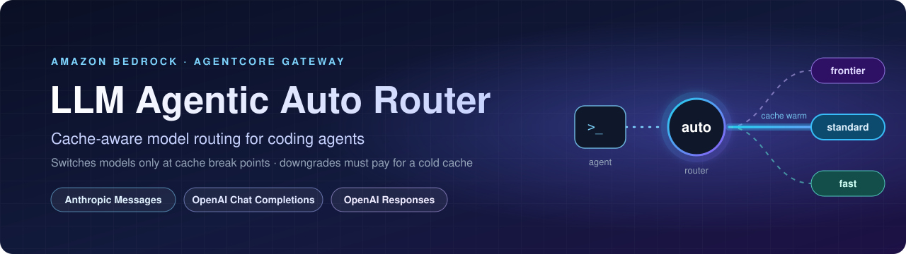
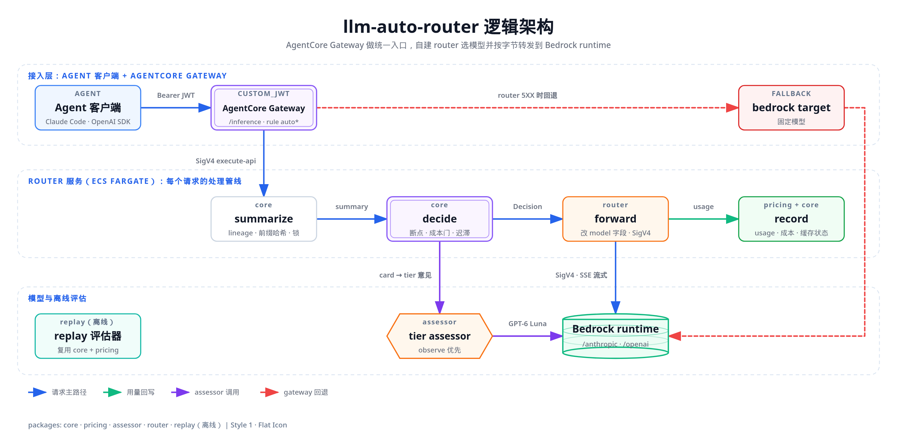

<div align="center">



<p>
  <a href="LICENSE"></a>
  
  
  
  
</p>

<p>
  <a href="#architecture"><b>Architecture</b></a> ·
  <a href="#connecting-clients"><b>Connecting clients</b></a> ·
  <a href="docs/console/README.md"><b>Console</b></a> ·
  <a href="infra/README.md"><b>Deploy</b></a> ·
  <a href="docs/experiments/harbor-summary.zh-CN.md"><b>Experiments</b></a> ·
  <a href="README.zh-CN.md"><b>简体中文</b></a>
</p>

</div>

# LLM agentic auto router

A cache-aware model router for agent traffic, deployed behind Amazon Bedrock AgentCore Gateway. Clients send
`model: auto` (or `auto:<tier>`) on the Anthropic Messages, OpenAI Chat Completions or OpenAI Responses API. The
router picks a Bedrock model per request, but switches models only at cache break points, so an agent's prompt
cache is not thrown away mid-task. A downgrade must pass a cost check: the projected saving over the next calls
has to beat the cost of starting the cheaper model with a cold cache. An optional LLM tier assessor classifies turns in observe mode: its verdicts are logged, not applied.

> [!IMPORTANT]
> **This is sample code for demonstration and education. It is not production-ready as is.** Review its
> security, cost and Bedrock / API Gateway quotas against your own requirements before you deploy it in your
> account. You are responsible for the AWS costs it incurs.
>
> The stack has a **fixed cost of about USD 113/month in ap-southeast-1 while it is deployed**, even with the
> router scaled to 0 tasks (interface endpoints and the internal NLB), plus per-task, per-request and token
> charges. Other Regions differ. **Destroy the stack when you finish testing.** See
> [infra/README.md, "Cost and teardown"](infra/README.md#cost-and-teardown).

## Architecture



Request path:

1. The client gets a Cognito access token (a member signs in with their own account, a service client uses client
   credentials) and calls **AgentCore Gateway** with it in `Authorization` and `x-api-key`. The gateway checks the JWT.
2. Every request goes to the router target: a **private REST API** (AWS_IAM), which the gateway calls with SigV4
   through its managed private endpoint.
3. The API forwards through a **VPC link** to an internal **NLB**, then to the router on **ECS Fargate**.
4. The router verifies the `x-api-key` token and records the caller, decides the model, rewrites only the
   top-level `model` field, SigV4-signs the call to **bedrock-runtime** over a VPC endpoint, and streams the
   response back.
5. If the router returns 5XX or cannot be reached, the gateway falls back to fixed models (Sonnet 5.5, then
   GPT-6.1 Sol). Those calls are not seen by the router, so they are not attributed or counted.

An optional **admin console** (a separate stack) lets admins manage members, service clients, the routing policy and
the assessor, and shows usage, list-price cost, savings and each routing decision. See
[docs/console/README.md](docs/console/README.md).

The detailed design document is in Chinese: [docs/architecture/architecture.zh-CN.md](docs/architecture/architecture.zh-CN.md).
The English design and requirement documents are indexed in [docs/README.md](docs/README.md).

## Repository layout

| Path | Contents |
|---|---|
| [packages/pricing](packages/pricing/README.md) | Versioned Bedrock price catalogs per Region and usage-cost accounting |
| [packages/core](docs/tasks/11-04-router-core/design.md) | The routing decision: tiers, cache break points, cost check, failover (pure, no I/O) |
| [packages/assessor](docs/tasks/11-04-llm-tier-assessor/research/README.md) | Optional LLM tier assessor, its prompt packs and offline evaluation |
| [packages/router](packages/router/README.md) | The `node:http` data-plane service behind the gateway |
| [packages/replay](docs/tasks/11-04-replay-evaluator/design.md) | Offline replay of agent traces against routing policies |
| packages/console-web, console-api, console-contract, usage-ingest | The admin console: web app, API, their shared contract, and the router-log ingest ([guide](docs/console/README.md)) |
| [tools/llmar](tools/llmar/README.md) | The member sign-in CLI (`llmar login`, `llmar-token`) |
| [infra](infra/README.md) | CDK app (TypeScript) for the gateway, private API, NLB, Fargate router and VPC |
| [spikes](spikes) | Verification experiments: gateway front door (V0–V8) and router hop options (V9 Lattice, V9d private REST API) |
| [docs](docs/README.md) | Architecture, design documents and research notes |

## Prerequisites and quick start

- Node.js 24 or later.
- pnpm through Corepack (`corepack enable`). The version is pinned in `package.json`.

```bash
corepack enable
pnpm install --frozen-lockfile
pnpm -r typecheck && pnpm -r test
```

The tests need no AWS account: the router's integration tests use a local fake Bedrock.

To deploy, follow [infra/README.md](infra/README.md). Region and account are explicit deploy parameters; nothing
falls back to your shell's Region:

```bash
cd infra && npx cdk deploy -c region=<aws-region> -c account=<account-id> -c prefix=<unique-prefix> ...
```

The Region needs a price catalog: one is bundled for `ap-northeast-1` and `ap-southeast-1`, or you can capture
one for another Region (see [packages/pricing/README.md](packages/pricing/README.md)). The shipped default
policy runs in observe mode: it logs the decisions it would make and serves `auto` requests with a fixed model.

## Connecting clients

Clients talk to the AgentCore Gateway with the provider's own API, the Anthropic Messages or the OpenAI Chat
Completions / Responses API. Nothing else in the client changes. There are two kinds of callers:

- **Members** (people) sign in with their own Cognito account through the `llmar` CLI. This is the normal path.
  The [admin console](docs/console/README.md)'s Get started page shows the same steps with this deployment's values.
- **Service clients** (CI jobs, agents) use the client-credentials flow with a client secret.

Both send their Cognito access token **twice**: as `Authorization: Bearer <token>` and as `x-api-key: <token>`.
The gateway authenticates the `Authorization` header. The router verifies the `x-api-key` copy and records who made
the call, so usage, cost and decisions are per caller. Client-asserted headers are never used as identity.

### What you need from the deployment

| Item | Where it comes from |
|---|---|
| Gateway URL | stack output `GatewayUrl`, e.g. `https://<gw-id>.gateway.bedrock-agentcore.<region>.amazonaws.com` |
| Console URL | console stack output `ConsoleUrl` (see [infra/README.md](infra/README.md#admin-console-console-stack)) |
| Member settings | the `llmar configure` block on the console's Get started page |
| Service client id and secret | the console's Service clients page (the secret is shown once) |
| Scope | `<prefix>/invoke` (`llmar/invoke` with the default prefix) |

### Endpoints, models and headers

| API | URL | SDK base URL |
|---|---|---|
| Anthropic Messages | `<GatewayUrl>/inference/v1/messages` | `<GatewayUrl>/inference` (the SDK appends `/v1/messages`) |
| OpenAI Chat Completions | `<GatewayUrl>/inference/v1/chat/completions` | `<GatewayUrl>/inference/v1` |
| OpenAI Responses | `<GatewayUrl>/inference/v1/responses` | `<GatewayUrl>/inference/v1` |

- **Model.** Send `model: "auto"`, or `auto:fast` / `auto:standard` / `auto:frontier` to ask for a tier. Every
  model name goes to the router. A concrete Bedrock model id is treated as a pin: it is served if it is in the
  router's policy and within your tier limit, otherwise the request gets 400 (`pin-not-allowed` or `access-cap`).
- **Auth.** `Authorization: Bearer <access token>` and `x-api-key: <access token>`. Member tokens last 30 minutes,
  service-client tokens 60 minutes. The `llmar` CLI refreshes member tokens for you.
- **Identity mode.** The router runs in `off`, `observe` or `require` mode (an admin setting). In `observe`, blocks,
  budgets and tier limits apply to every call that carries a valid `x-api-key`; a call without one is served
  unattributed and escapes them. In `require`, such a call gets 401, so they bind everyone.
- **Optional request headers.** The gateway forwards only these: `x-api-key`, `x-router-session`,
  `x-router-parent-session`, `x-router-agent-id`, `x-router-hint`, `x-claude-code-session-id`, `x-session-id`,
  `anthropic-version`, `anthropic-beta` and `openai-beta`.
  - `x-router-session: <id>` keeps one agent session on one lineage. Cache-aware routing depends on it. Use one
    stable id per agent session, never a shared constant. Claude Code's own `x-claude-code-session-id` is read
    the same way.
  - `x-router-hint: pin=<model id>` serves that model. `x-router-hint: tier=frontier` asks for a tier. Combine
    several keys with `;`.
- **Response headers:** `x-router-decision`, `x-router-model` (the model that served the call) and `x-router-reason`.
- **Observe mode (the shipped default policy).** Every `auto*` request is served by the policy's observe default:
  Sonnet 5.5 on Messages, GPT-6.1 Sol on Chat and Responses. The decision the router *would* make is only logged.
  Tier aliases and `tier=` hints take effect only with a policy in `auto` mode. Pins work in both modes.

### Members: sign in with `llmar`

`llmar` is one Python 3.9+ file with no dependencies outside the standard library ([tools/llmar](tools/llmar/README.md)).

```bash
mkdir -p ~/bin
curl -fsSLo ~/bin/llmar <raw URL of tools/llmar/llmar> && chmod +x ~/bin/llmar
ln -sf llmar ~/bin/llmar-token && ln -sf llmar ~/bin/llmar-login
llmar configure --from '<JSON block from the console Get started page>'
llmar login      # browser sign-in with your password
llmar status     # who you are and when the token expires
```

- **No console?** Build the `configure` block from the router stack outputs: `{"cognitoDomain": "<TokenEndpoint
  without /oauth2/token>", "clientId": "<CliClientId>", "scope": "<prefix>/invoke", "redirectPorts": [52817, 52818,
  52819], "gatewayUrl": "<GatewayUrl>"}` (the ports are the `cliRedirectPorts` deploy value).
- `llmar-token` prints a valid access token and nothing else. It answers from its cache and refreshes the token 5
  minutes before it expires. Claude Code, Codex and your code call it.
- On a machine without a browser (SSH), run `llmar login --no-browser`. It prints the link and an `ssh -L` command
  for the callback port.
- The sign-in lasts 30 days. Sign in again after that, after "Sign out everywhere", or after an admin re-enabled
  your account.
- If the sign-in service is unreachable but the cached token has more than 30 seconds left, `llmar-token` prints it
  (exit 0) with a warning on stderr. Otherwise its exit codes are: 2 = sign in again (`run llmar login`): the
  sign-in expired or was revoked, or the settings changed (`llmar configure`) since sign-in; 3 = the sign-in service
  is unreachable and no usable cached token is left; 4 = a setup problem: missing settings, a credentials file
  other users can read, the `llmar` directory or its parent writable by others, or bad usage.

### Claude Code

In `~/.claude/settings.json`, or a project's `.claude/settings.json`:

```json
{
  "apiKeyHelper": "~/bin/llmar-token",
  "env": {
    "ANTHROPIC_BASE_URL": "https://<gw-id>.gateway.bedrock-agentcore.<region>.amazonaws.com/inference",
    "ANTHROPIC_MODEL": "auto",
    "ANTHROPIC_DEFAULT_OPUS_MODEL": "auto:frontier",
    "ANTHROPIC_DEFAULT_SONNET_MODEL": "auto:standard",
    "ANTHROPIC_DEFAULT_HAIKU_MODEL": "auto:fast",
    "CLAUDE_CODE_API_KEY_HELPER_TTL_MS": "240000",
    "CLAUDE_CODE_DISABLE_NONESSENTIAL_TRAFFIC": "1"
  }
}
```

- **Tokens.** Claude Code sends the helper's output both as a bearer token and as `X-Api-Key`, so no extra setting
  is needed. The 4-minute TTL makes it ask `llmar-token` often; `llmar` answers from its cache.
- **Choosing a tier.** The alias variables make `/model opus|sonnet|haiku` ask the router for a tier rather than a
  fixed model. Claude Code prints an `unrecognized_model` notice for `auto`, which is harmless.
- **Request compatibility.** Claude Code's session header is forwarded, and its JSON `metadata.user_id` and the
  `advanced-tool-use` beta, which Bedrock rejects, are normalised by the router.
- **Token counting.** The gateway does not expose `/v1/messages/count_tokens`. Claude Code gets a 404 and falls
  back to its own estimate.
- **Refusal fallback.** If the served model refuses on safety grounds, Claude Code 2.1 may retry with its built-in
  fallback model, for example `claude-opus-4-8`. That id is not in the router's policy, so the retry gets 400. See
  [docs/experiments/claude-code-harbor.zh-CN.md](docs/experiments/claude-code-harbor.zh-CN.md) §5.1.

### Codex

Codex cannot send one refreshing token in two headers. For sessions of any length, it uses two sign-ins: `llmar`
for `Authorization`, and Codex's own browser sign-in for `x-api-key`. In `~/.codex/config.toml`:

```toml
model = "auto"
model_provider = "llmar"
model_context_window = 1000000         # "auto" is unknown to Codex; the smallest window of the routed GPT models
model_auto_compact_token_limit = 700000
web_search = "disabled"                # required: Bedrock rejects Codex's built-in web search tool mid-stream

[model_providers.llmar]
name = "llmar router"
base_url = "https://<gw-id>.gateway.bedrock-agentcore.<region>.amazonaws.com/inference/v1"
wire_api = "responses"
env_http_headers = { "x-router-session" = "LLMAR_SESSION" }
requires_openai_auth = false
supports_websockets = false

[model_providers.llmar.auth]           # Authorization: Bearer, refreshed by llmar
command = "/home/<you>/bin/llmar-token" # a resolved absolute path, as the Codex docs ask
timeout_ms = 15000
refresh_interval_ms = 240000

[model_providers.llmar.gateway_oauth]  # Codex's own sign-in; its token goes in x-api-key
authorization_url = "https://<domain>.auth.<region>.amazoncognito.com/oauth2/authorize"
token_url = "https://<domain>.auth.<region>.amazoncognito.com/oauth2/token"
client_id = "<cli client id>"
scopes = ["openid", "<prefix>/invoke"]
redirect_port = 52820                  # the port registered for Codex on the cli app client
delivery = { kind = "header", name = "x-api-key" }

[features]
enable_request_compression = false     # the gateway/router path takes identity-encoded JSON
```

Then run `LLMAR_SESSION=$(uuidgen) codex`. Codex opens its own sign-in page once.

- **Over SSH**, Codex's own sign-in needs its callback port forwarded too:
  `ssh -L 52820:127.0.0.1:52820 <host>`. Codex prints the sign-in URL; open it on
  your own computer.
- **Headless Linux without a keyring.** Codex stores its sign-in in the OS keyring by default. Add
  `credentials_store = "file"` to the `gateway_oauth` table to keep it in `$CODEX_HOME/secrets/gateway_oauth.json`
  instead (mode 0600, plain text).
- **Short sessions (under 30 minutes)** can skip the second sign-in. Leave out the `auth` and `gateway_oauth`
  tables, set `env_key = "LLMAR_TOKEN"` and
  `env_http_headers = { "x-router-session" = "LLMAR_SESSION", "x-api-key" = "LLMAR_TOKEN" }`, and run
  `LLMAR_TOKEN=$(llmar-token) LLMAR_SESSION=$(uuidgen) codex`. Codex reads the token once at start.
- **Web search must be off.** With Codex's default web search tool in the request, Bedrock ends every stream with
  "web search is not supported for this request". Codex then reports "stream disconnected before
  response.completed" and retries until it gives up.
- **The `Model metadata for 'auto' not found` warning is harmless.** That is why the context-window keys are set.
- **Context window.** 1,000,000 is the smallest window among the routed GPT models (GPT-6.1 Sol; Astra and Luna
  have 1.05M). Prompts above 272k tokens are billed at the long-context rate, so lower both values if you want to
  stay under that step.
- **"auth command exited with status 2".** Codex does not show why. Run `llmar-token` in a terminal: usually you
  need to run `llmar login` again.

### From code

Both SDKs take an `httpx` auth hook that sets both headers on every request, so a long-running process never sends
an expired token:

```python
import subprocess, uuid
import anthropic, openai
import httpx2 as httpx   # anthropic>=2 / openai>=3 ship httpx2; older releases use httpx

GW = 'https://<gw-id>.gateway.bedrock-agentcore.<region>.amazonaws.com'

def router_token() -> str:   # llmar answers from its cache and refreshes 5 min before expiry
    return subprocess.run(['llmar-token'], capture_output=True, text=True, check=True).stdout.strip()

class RouterAuth(httpx.Auth):
    def auth_flow(self, request):
        t = router_token()
        request.headers['authorization'] = f'Bearer {t}'
        request.headers['x-api-key'] = t
        yield request

session = {'x-router-session': str(uuid.uuid4())}   # one id per agent session
claude = anthropic.Anthropic(base_url=f'{GW}/inference', auth_token='unused', default_headers=session,
                             http_client=httpx.Client(auth=RouterAuth()))
oai = openai.OpenAI(base_url=f'{GW}/inference/v1', api_key='unused', default_headers=session,
                    http_client=httpx.Client(auth=RouterAuth()))

msg = claude.messages.create(model='auto', max_tokens=512, messages=[{'role': 'user', 'content': 'Hello'}])
chat = oai.chat.completions.create(model='auto', messages=[{'role': 'user', 'content': 'Hello'}])
resp = oai.responses.create(model='auto', input='Hello', store=False)
```

```bash
TOKEN=$(llmar-token)
curl -sS "$GW/inference/v1/messages" -H "Authorization: Bearer $TOKEN" -H "x-api-key: $TOKEN" \
  -H 'content-type: application/json' -H 'anthropic-version: 2023-06-01' -H "x-router-session: $(uuidgen)" \
  -d '{"model": "auto", "max_tokens": 256, "messages": [{"role": "user", "content": "Say ok."}]}' -D -
```

To read the routing decision, use `with_raw_response` (`claude.messages.with_raw_response.create(...)`, then
`.headers['x-router-model']`). Streaming works on all three APIs with the SDKs' usual calls (`messages.stream(...)`,
`stream=True`).

### Service clients (CI and agents)

An admin creates a service client on the console's Service clients page and copies the secret, which is shown once.
Keep the client id, secret and token endpoint in a Secrets Manager secret that only that job can read, for example a
JSON string `{"client_id": …, "client_secret": …, "token_url": …}`. Do not put the secret in config files. Budgets
and tier limits apply to service clients as they do to members.

This helper prints a client-credentials access token. Save it as `~/bin/llmar-m2m-token` (its own name, so it does
not clash with the member CLI) and `chmod +x` it:

```python
#!/usr/bin/env python3
# llmar-m2m-token: print a Cognito access token for a service client (needs boto3 and read access to the secret).
import base64, json, os, urllib.parse, urllib.request
import boto3

s = json.loads(boto3.client('secretsmanager').get_secret_value(SecretId=os.environ.get('LLMAR_SECRET_ID', 'llmar/client'))['SecretString'])
basic = base64.b64encode(f"{s['client_id']}:{s['client_secret']}".encode()).decode()
data = urllib.parse.urlencode({'grant_type': 'client_credentials', 'scope': os.environ.get('LLMAR_SCOPE', 'llmar/invoke')}).encode()
req = urllib.request.Request(s['token_url'], data=data, headers={'Authorization': f'Basic {basic}',
                             'Content-Type': 'application/x-www-form-urlencoded'})
with urllib.request.urlopen(req, timeout=30) as r:
    print(json.load(r)['access_token'])
```

Send its token in both headers, exactly as above (`router_token()` can call `llmar-m2m-token` instead). Each call
mints a new token, which Cognito bills per token: a long-running job should cache it for up to 60 minutes.

> **Tested on 2026-11-08**, in two runs against a deployed stack with the shipped observe policy:
> - **Clients, before identity was added:** curl on all three endpoints; the Anthropic and OpenAI Python SDKs,
>   streaming and non-streaming; Claude Code 2.1.318, including multi-turn tool use and `--model opus` arriving as
>   `auto:frontier`; Codex 0.167, including a shell tool call. Every `auto*` call was served by the observe default,
>   `pin=` was honoured and an unknown pin got 400.
> - **End to end with identity and the console** (ap-southeast-1): a service client with both headers; a member invited, then
>   `llmar configure` and `llmar login`, calls on all three APIs, Claude Code with `apiKeyHelper` and Codex with
>   `auth.command` plus `x-api-key`, all attributed to the member; a concrete model id served as a pin. Requests
>   with no token or a bad token got 401. In `require` mode a call without `x-api-key` got 401 `identity-missing`,
>   a disabled member got 403 `identity-blocked`, and a member over a hard-stop budget got 429 `budget-exceeded`.

## Security

The router has no internet path: its subnets have no internet gateway or NAT, and AWS services are reached
through VPC endpoints. The gateway-to-router hop is SigV4-signed (AWS_IAM on the private REST API), and the
API's resource policy admits only the gateway's role through its own VPC endpoint. IAM is least-privilege: the
task role may invoke exactly the models in the router's policy, and the gateway role only the fallback models.
Credentials and tokens are never logged. Details are in [infra/README.md](infra/README.md#iam).

Caller identity comes only from a verified token. The router checks the `x-api-key` JWT itself (signature against
the user pool's keys, issuer, token use, expiry and scope); session and hint headers are never identity. The
console is reachable only behind Cognito sign-in (MFA is off by default; require it for production, see
[infra/README.md](infra/README.md#production-hardening-mfa)), and every API route checks the caller's
role on the server. Prompt and output text are never stored.

TLS ends at API Gateway. The last leg inside the VPC (VPC link → internal NLB → router task on port 8080) is plain
HTTP: the NLB's security group has no ingress rules and admits only VPC link traffic, and the router's security
group admits only the NLB. If your policy requires encryption on that leg as well, add a TLS listener with an
ACM certificate to the NLB and point the API Gateway integration at `https://`.

See [CONTRIBUTING](CONTRIBUTING.md#security-issue-notifications) for more information.

## License

This library is licensed under the MIT-0 License. See the LICENSE file.

## Third-party data

- The offline assessor evaluations reference [SWE-bench Verified](https://www.swebench.com/) by instance id and
  aggregate results only. No dataset text is in this repository.
- The replay evaluator can use [TraceLab](https://github.com/uw-syfi/TraceLab) traces (CC BY 4.0). They are not
  committed; see [packages/replay/data/README.md](packages/replay/data/README.md) for how to fetch them and the
  attribution.
