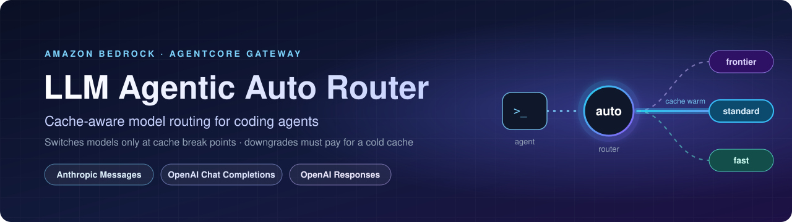
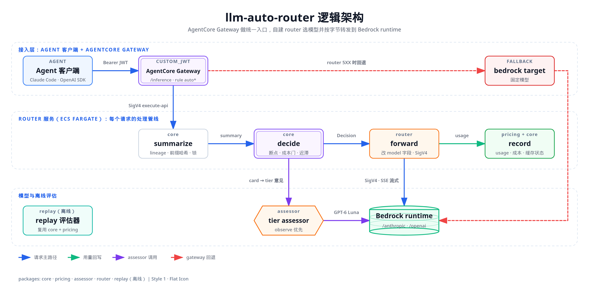

<div align="center">



<p>
  <a href="LICENSE"></a>
  
  
  
  
</p>

<p>
  <a href="#架构"><b>架构</b></a> ·
  <a href="#客户端接入"><b>客户端接入</b></a> ·
  <a href="docs/console/README.zh-CN.md"><b>控制台</b></a> ·
  <a href="infra/README.md"><b>部署</b></a> ·
  <a href="docs/experiments/harbor-summary.zh-CN.md"><b>实验结论</b></a> ·
  <a href="README.md"><b>English</b></a>
</p>

</div>

# LLM agentic auto router

一个面向 agent 流量的缓存感知模型路由器，部署在 Amazon Bedrock AgentCore Gateway 之后。

- **接入方式：** 客户端用 Anthropic Messages、OpenAI Chat Completions 或 OpenAI Responses 接口发送 `model: auto`（或 `auto:<档位>`），router 为每个请求选择一个 Bedrock 模型。
- **只在缓存断点切换模型：** agent 的提示缓存不会在任务中途被丢掉。
- **降档要过成本检查：** 预计在后续调用上省下的钱，必须超过换到更便宜模型、从冷缓存重新开始的代价。
- **可选的 LLM 档位评估器：** 以观察模式运行，判定只记录，不生效。

> [!IMPORTANT]
> **这是用于演示和学习的示例代码，不能直接用于生产。** 在自己的账号里部署之前，请对照自身要求评估它的安全性、成本以及 Bedrock / API Gateway 配额。部署产生的 AWS 费用由你承担。
>
> 只要 stack 处于部署状态，就有**固定成本，在 ap-southeast-1 约 USD 113/月**。即使 router 缩到 0 个任务也一样，这部分来自接口终端节点和内部 NLB。此外还有按任务、按请求和按 token 计的费用，其他区域价格不同。**测试结束后请销毁 stack**，见 [infra/README.md 的 “Cost and teardown”](infra/README.md#cost-and-teardown)。

## 架构



请求路径：

1. 客户端获取 Cognito access token（成员用自己的账号登录，服务客户端用 client credentials），把它放在 `Authorization` 和 `x-api-key` 里调用 **AgentCore Gateway**，由网关校验 JWT。
2. 所有请求都进入 router 目标：一个 **私有 REST API**（AWS_IAM）。网关通过它托管的私有终端节点，用 SigV4 签名调用这个 API。
3. API 经 **VPC link** 转发到内部 **NLB**，再到运行在 **ECS Fargate** 上的 router。
4. router 校验 `x-api-key` 里的 token 并记录调用方，然后决定模型，只改写顶层的 `model` 字段，经 VPC 终端节点用 SigV4 签名调用 **bedrock-runtime**，并把响应流式返回。
5. 如果 router 返回 5XX 或不可达，网关回退到固定模型：先 Sonnet 5.5，再 GPT-6.1 Sol。这些调用 router 看不到，所以不会归属到调用方，也不计入统计。

可选的 **管理控制台**（单独的 stack）供管理员管理成员、服务客户端、路由策略和评估器，并展示用量、目录价成本、节省和每一次路由决策。见 [docs/console/README.zh-CN.md](docs/console/README.zh-CN.md)。

详细设计文档：[docs/architecture/architecture.zh-CN.md](docs/architecture/architecture.zh-CN.md)。英文的设计与需求文档索引见 [docs/README.md](docs/README.md)。

## 仓库结构

| 路径 | 内容 |
|---|---|
| [packages/pricing](packages/pricing/README.md) | 按区域、带版本的 Bedrock 价格目录，以及用量计费 |
| [packages/core](docs/tasks/11-04-router-core/design.md) | 路由决策：档位、缓存断点、成本检查、故障切换（纯函数，无 I/O） |
| [packages/assessor](docs/tasks/11-04-llm-tier-assessor/research/README.md) | 可选的 LLM 档位评估器、它的提示词包和离线评估 |
| [packages/router](packages/router/README.md) | 网关之后基于 `node:http` 的数据面服务 |
| [packages/replay](docs/tasks/11-04-replay-evaluator/design.md) | 用 agent 轨迹离线回放、比较路由策略 |
| packages/console-web、console-api、console-contract、usage-ingest | 管理控制台：网页、API、二者共用的接口约定，以及 router 日志的导入（[使用说明](docs/console/README.zh-CN.md)） |
| [tools/llmar](tools/llmar/README.md) | 成员登录命令行（`llmar login`、`llmar-token`） |
| [infra](infra/README.md) | CDK 应用（TypeScript）：网关、私有 API、NLB、Fargate 上的 router 和 VPC |
| [spikes](spikes) | 验证实验：网关入口（V0–V8），以及 router 链路的几种方案（V9 Lattice、V9d 私有 REST API） |
| [docs](docs/README.md) | 架构、设计文档和调研笔记 |

## 前置条件与快速开始

- Node.js 24 或更高版本。
- 通过 Corepack 使用 pnpm（`corepack enable`），版本固定在 `package.json` 中。

```bash
corepack enable
pnpm install --frozen-lockfile
pnpm -r typecheck && pnpm -r test
```

测试不需要 AWS 账号：router 的集成测试使用本地的假 Bedrock。

部署请按 [infra/README.md](infra/README.md) 操作。区域和账号都是显式的部署参数，不会回退到 shell 里的默认区域：

```bash
cd infra && npx cdk deploy -c region=<aws-region> -c account=<account-id> -c prefix=<unique-prefix> ...
```

部署区域需要一份价格目录：仓库自带 `ap-northeast-1` 和 `ap-southeast-1` 两份，其他区域可以自行采集，见 [packages/pricing/README.md](packages/pricing/README.md)。默认策略以观察模式运行：记录它本会做出的决策，`auto` 请求由固定模型服务。

## 客户端接入

客户端直接用模型厂商自己的接口访问 AgentCore Gateway，也就是 Anthropic Messages，或 OpenAI 的 Chat Completions / Responses。客户端的其他部分都不用改。调用方有两类：

- **成员**（人）：通过 `llmar` 命令行用自己的 Cognito 账号登录。这是常规方式。[管理控制台](docs/console/README.zh-CN.md)的“接入指南”页给出同样的步骤，并填好本部署的信息。
- **服务客户端**（CI 任务、agent）：用 client secret 走 client credentials 流程。

两类调用方都要把 Cognito access token **发两次**：一次是 `Authorization: Bearer <token>`，一次是 `x-api-key: <token>`。网关校验 `Authorization` 头；router 校验 `x-api-key` 里的副本，并记录是谁发的请求，所以用量、成本和决策都能按调用方统计。客户端自行声明的头从不作为身份依据。

### 从部署中获取的信息

| 项 | 来源 |
|---|---|
| 网关地址 | stack 输出 `GatewayUrl`，形如 `https://<gw-id>.gateway.bedrock-agentcore.<region>.amazonaws.com` |
| 控制台地址 | 控制台 stack 的输出 `ConsoleUrl`（见 [infra/README.md](infra/README.md#admin-console-console-stack)） |
| 成员配置 | 控制台“接入指南”页上的 `llmar configure` 配置块 |
| 服务客户端的 id 和 secret | 控制台的“服务客户端”页（secret 只显示一次） |
| Scope | `<prefix>/invoke`（默认前缀下是 `llmar/invoke`） |

### 端点、模型和请求头

| 接口 | URL | SDK 的 base URL |
|---|---|---|
| Anthropic Messages | `<GatewayUrl>/inference/v1/messages` | `<GatewayUrl>/inference`（SDK 会自动拼上 `/v1/messages`） |
| OpenAI Chat Completions | `<GatewayUrl>/inference/v1/chat/completions` | `<GatewayUrl>/inference/v1` |
| OpenAI Responses | `<GatewayUrl>/inference/v1/responses` | `<GatewayUrl>/inference/v1` |

- **模型。**
  - 发送 `model: "auto"`；要指定档位就发 `auto:fast` / `auto:standard` / `auto:frontier`。
  - 所有模型名都会进入 router。
  - 写具体的 Bedrock 模型 id 等同于指定模型（pin）：该模型在 router 的策略里、且不超过你的档位上限时才会被服务，否则返回 400（`pin-not-allowed` 或 `access-cap`）。
- **认证。** `Authorization: Bearer <access token>` 加 `x-api-key: <access token>`。成员和服务客户端的 token 有效期都是 60 分钟。成员的 token 由 `llmar` 自动刷新。
- **身份识别模式。** router 运行在 `off`、`observe` 或 `require` 模式（管理员设置）。`observe` 下，拦截、预算和档位上限对每个带有效 `x-api-key` 的调用都生效；不带的调用照常服务、不归属，也不受这些约束。`require` 下这类调用返回 401，所以约束对所有人都有效。
- **可选请求头。** 网关只转发这些：`x-api-key`、`x-router-session`、`x-router-parent-session`、`x-router-agent-id`、`x-router-hint`、`x-claude-code-session-id`、`x-session-id`、`anthropic-version`、`anthropic-beta`、`openai-beta`。
  - `x-router-session: <id>`：让同一个 agent 会话保持在同一条 lineage 上，缓存感知路由依赖它。每个 agent 会话用一个稳定的 id，不要所有会话共用一个常量。Claude Code 自带的 `x-claude-code-session-id` 按同样方式读取。
  - `x-router-hint: pin=<模型 id>`：用指定模型服务。`x-router-hint: tier=frontier`：请求某个档位。多个键用 `;` 连接。
- **响应头：** `x-router-decision`、`x-router-model`（实际服务的模型）、`x-router-reason`。
- **观察模式（默认策略）。**
  - 所有 `auto*` 请求都由策略的观察默认模型服务：Messages 用 Sonnet 5.5，Chat 和 Responses 用 GPT-6.1 Sol。router *本会* 做出的决策只记录在日志里。
  - 档位别名和 `tier=` 提示只在 `auto` 模式的策略下生效；指定模型在两种模式下都生效。

### 成员：用 `llmar` 登录

`llmar` 是一个 Python 3.9+ 文件，只用标准库（[tools/llmar](tools/llmar/README.md)）。

```bash
mkdir -p ~/bin
curl -fsSLo ~/bin/llmar <raw URL of tools/llmar/llmar> && chmod +x ~/bin/llmar
ln -sf llmar ~/bin/llmar-token && ln -sf llmar ~/bin/llmar-login
llmar configure --from '<JSON block from the console Get started page>'
llmar login      # browser sign-in with your password
llmar status     # who you are and when the token expires
```

- **没有部署控制台？** 用 router stack 的输出拼出 `configure` 配置块：`{"cognitoDomain": "<TokenEndpoint 去掉 /oauth2/token>", "clientId": "<CliClientId>", "scope": "<prefix>/invoke", "redirectPorts": [52817, 52818, 52819], "gatewayUrl": "<GatewayUrl>"}`（端口取部署参数 `cliRedirectPorts` 的值）。
- `llmar-token` 只打印一个有效的 access token。它直接用缓存回答，并在过期前 5 分钟刷新。Claude Code、Codex 和你的代码都调用它。
- 机器上没有浏览器（例如通过 SSH）时，运行 `llmar login --no-browser`。它会打印登录链接，以及转发回调端口用的 `ssh -L` 命令。
- 登录有效期 30 天。超过 30 天、点了“在所有设备上退出”，或者管理员重新启用了你的账号之后，都要重新登录。
- 连不上登录服务、但缓存的 token 还剩 30 秒以上时，`llmar-token` 照常打印它（退出码 0），并在 stderr 给出警告。其他情况的退出码：2 = 需要重新登录（`run llmar login`）：登录已过期或被撤销，或者登录后改过配置（`llmar configure`）；3 = 连不上登录服务，且没有可用的缓存 token；4 = 配置有问题：缺少配置、凭证文件其他用户也能读、`llmar` 目录或它的上级目录其他用户可写，或者命令用法不对。

### Claude Code

在 `~/.claude/settings.json` 或项目的 `.claude/settings.json` 中：

```json
{
  "apiKeyHelper": "~/bin/llmar-token",
  "env": {
    "ANTHROPIC_BASE_URL": "https://<gw-id>.gateway.bedrock-agentcore.<region>.amazonaws.com/inference",
    "CLAUDE_CODE_USE_BEDROCK": "0",
    "ANTHROPIC_MODEL": "auto",
    "ANTHROPIC_DEFAULT_OPUS_MODEL": "auto:frontier",
    "ANTHROPIC_DEFAULT_SONNET_MODEL": "auto:standard",
    "ANTHROPIC_DEFAULT_HAIKU_MODEL": "auto:fast",
    "CLAUDE_CODE_MAX_CONTEXT_TOKENS": "1000000",
    "CLAUDE_CODE_API_KEY_HELPER_TTL_MS": "240000",
    "CLAUDE_CODE_DISABLE_NONESSENTIAL_TRAFFIC": "1"
  }
}
```

- **Token：** Claude Code 把脚本的输出同时作为 bearer token 和 `X-Api-Key` 发送，不需要额外设置。TTL 设为 4 分钟，它会经常调用 `llmar-token`；`llmar` 直接用缓存回答。Claude Code 在后台刷新时，可能在 TTL 过后继续用缓存的 token；如果网关拒绝它（过期的 token 会得到 403 `insufficient_scope`），Claude Code 会再要一次，`llmar` 就会换发新 token。
- **选择档位：** 有了这几个别名变量，`/model opus|sonnet|haiku` 就是向 router 请求对应档位，而不是固定某个模型。
- **上下文窗口：** Claude Code 不认识 `auto` 这个名字，会假定窗口只有 200K 并在 200K 压缩对话。`CLAUDE_CODE_MAX_CONTEXT_TOKENS` 告诉它 router 的 Claude 模型是 1M 窗口。
- **请求兼容：** Claude Code 的会话头会被转发。它的 JSON 格式 `metadata.user_id` 和 `advanced-tool-use` beta 头 Bedrock 不接受，由 router 自动处理。
- **Token 计数：** 网关没有开放 `/v1/messages/count_tokens`。Claude Code 收到 404 后会改用自己的估算。
- **拒答回退：** 如果模型出于安全原因拒答，Claude Code 2.1 可能改用内置的回退模型重试，例如 `claude-opus-4-8`。这个 id 不在 router 的策略里，重试会返回 400。见 [docs/experiments/claude-code-harbor.zh-CN.md](docs/experiments/claude-code-harbor.zh-CN.md) §5.1。

### Codex

Codex 没法把同一个会刷新的 token 放进两个头。所以不论会话长短，它都用两次登录：`llmar` 负责 `Authorization`，Codex 自己的浏览器登录负责 `x-api-key`。在 `~/.codex/config.toml` 中：

```toml
model = "auto"
model_provider = "llmar"
model_context_window = 1000000         # "auto" is unknown to Codex; the smallest window of the routed GPT models
model_auto_compact_token_limit = 700000
web_search = "disabled"                # required: Bedrock rejects Codex's built-in web search tool mid-stream

[model_providers.llmar]
name = "llmar router"
base_url = "https://<gw-id>.gateway.bedrock-agentcore.<region>.amazonaws.com/inference/v1"
wire_api = "responses"
env_http_headers = { "x-router-session" = "LLMAR_SESSION" }
requires_openai_auth = false
supports_websockets = false

[model_providers.llmar.auth]           # Authorization: Bearer, refreshed by llmar
command = "/home/<you>/bin/llmar-token" # a resolved absolute path, as the Codex docs ask
timeout_ms = 15000
refresh_interval_ms = 240000

[model_providers.llmar.gateway_oauth]  # Codex's own sign-in; its token goes in x-api-key
authorization_url = "https://<domain>.auth.<region>.amazoncognito.com/oauth2/authorize"
token_url = "https://<domain>.auth.<region>.amazoncognito.com/oauth2/token"
client_id = "<cli client id>"
scopes = ["openid", "<prefix>/invoke"]
redirect_port = 52820                  # the port registered for Codex on the cli app client
delivery = { kind = "header", name = "x-api-key" }
# credentials_store = "file"           # headless Linux without a keyring: keep this sign-in in $CODEX_HOME/secrets/

[memories]                             # background memory passes name their own model: keep them on the router
extract_model = "auto:fast"
consolidation_model = "auto:fast"

[features]
enable_request_compression = false     # the gateway/router path takes identity-encoded JSON
```

然后运行 `LLMAR_SESSION=$(uuidgen) codex`。Codex 会打开一次它自己的登录页。

- **通过 SSH 使用时**，Codex 自己的登录也要转发回调端口：`ssh -L 52820:127.0.0.1:52820 <host>`。Codex 会打印登录链接，在你自己的电脑上打开。
- **没有密钥环的无界面 Linux。** Codex 默认把登录信息存在系统密钥环里。在 `gateway_oauth` 一段加上 `credentials_store = "file"`，改存到 `$CODEX_HOME/secrets/gateway_oauth.json`（权限 0600，明文）。
- **短会话（60 分钟以内）可以省掉第二次登录。** 去掉 `auth` 和 `gateway_oauth` 两段，设置 `env_key = "LLMAR_TOKEN"` 和 `env_http_headers = { "x-router-session" = "LLMAR_SESSION", "x-api-key" = "LLMAR_TOKEN" }`，再运行 `LLMAR_TOKEN=$(llmar-token) LLMAR_SESSION=$(uuidgen) codex`。Codex 只在启动时读一次 token。
- **必须关闭网页搜索。** 请求里如果带着 Codex 默认的网页搜索工具，Bedrock 会在每个流里返回 “web search is not supported for this request” 并结束。Codex 表现为 “stream disconnected before response.completed”，反复重试后失败。
- **`Model metadata for 'auto' not found` 警告可以忽略。** 正因为 Codex 不认识 `auto`，配置里才要手动设上下文窗口。
- **上下文窗口。** 1,000,000 是可路由 GPT 模型中最小的窗口（GPT-6.1 Sol；Astra 和 Luna 为 1.05M）。提示超过 272k token 的部分按长上下文价格计费；想留在这个价格档以下，就把两个值都调低。
- **“auth command exited with status 2”。** Codex 不显示原因。在终端里运行 `llmar-token` 查看，通常是需要重新运行 `llmar login`。

### 代码接入

两个 SDK 都可以接一个 `httpx` 认证钩子，在每次请求时设置两个头，所以长时间运行的进程也不会发出过期的 token：

```python
import subprocess, uuid
import anthropic, openai
import httpx2 as httpx   # anthropic>=2 / openai>=3 ship httpx2; older releases use httpx

GW = 'https://<gw-id>.gateway.bedrock-agentcore.<region>.amazonaws.com'

def router_token() -> str:   # llmar answers from its cache and refreshes 5 min before expiry
    return subprocess.run(['llmar-token'], capture_output=True, text=True, check=True).stdout.strip()

class RouterAuth(httpx.Auth):
    def auth_flow(self, request):
        t = router_token()
        request.headers['authorization'] = f'Bearer {t}'
        request.headers['x-api-key'] = t
        yield request

session = {'x-router-session': str(uuid.uuid4())}   # one id per agent session
claude = anthropic.Anthropic(base_url=f'{GW}/inference', auth_token='unused', default_headers=session,
                             http_client=httpx.Client(auth=RouterAuth()))
oai = openai.OpenAI(base_url=f'{GW}/inference/v1', api_key='unused', default_headers=session,
                    http_client=httpx.Client(auth=RouterAuth()))

msg = claude.messages.create(model='auto', max_tokens=512, messages=[{'role': 'user', 'content': 'Hello'}])
chat = oai.chat.completions.create(model='auto', messages=[{'role': 'user', 'content': 'Hello'}])
resp = oai.responses.create(model='auto', input='Hello', store=False)
```

```bash
TOKEN=$(llmar-token)
curl -sS "$GW/inference/v1/messages" -H "Authorization: Bearer $TOKEN" -H "x-api-key: $TOKEN" \
  -H 'content-type: application/json' -H 'anthropic-version: 2023-06-01' -H "x-router-session: $(uuidgen)" \
  -d '{"model": "auto", "max_tokens": 256, "messages": [{"role": "user", "content": "Say ok."}]}' -D -
```

- **查看路由决策：** 用 `with_raw_response`，即先 `claude.messages.with_raw_response.create(...)`，再读 `.headers['x-router-model']`。
- **流式调用：** 三种接口都支持，用 SDK 的常规写法即可（`messages.stream(...)`、`stream=True`）。

### 服务客户端（CI 和 agent）

管理员在控制台的“服务客户端”页创建服务客户端，并复制 secret（只显示一次）。把 client id、secret 和 token 端点存进只有这个任务能读的 Secrets Manager secret，例如一个 JSON 字符串 `{"client_id": …, "client_secret": …, "token_url": …}`。不要把 secret 写进配置文件。预算和档位上限对服务客户端同样有效。

下面这个小脚本打印一个 client credentials 的 access token。保存为 `~/bin/llmar-m2m-token`（单独起名，避免和成员命令行冲突），并 `chmod +x`：

```python
#!/usr/bin/env python3
# llmar-m2m-token: print a Cognito access token for a service client (needs boto3 and read access to the secret).
import base64, json, os, urllib.parse, urllib.request
import boto3

s = json.loads(boto3.client('secretsmanager').get_secret_value(SecretId=os.environ.get('LLMAR_SECRET_ID', 'llmar/client'))['SecretString'])
basic = base64.b64encode(f"{s['client_id']}:{s['client_secret']}".encode()).decode()
data = urllib.parse.urlencode({'grant_type': 'client_credentials', 'scope': os.environ.get('LLMAR_SCOPE', 'llmar/invoke')}).encode()
req = urllib.request.Request(s['token_url'], data=data, headers={'Authorization': f'Basic {basic}',
                             'Content-Type': 'application/x-www-form-urlencoded'})
with urllib.request.urlopen(req, timeout=30) as r:
    print(json.load(r)['access_token'])
```

它打印的 token 同样要放进两个头，和上面完全一样（`router_token()` 改为调用 `llmar-m2m-token` 即可）。每次调用都会签发一个新 token，Cognito 按签发的 token 计费；长时间运行的任务应当缓存它，最多 60 分钟。

> **2026-11-08 实测**，两轮，都是对运行默认观察策略的已部署 stack：
> - **客户端（加入身份识别之前）：** curl 访问三个端点；Anthropic 和 OpenAI 的 Python SDK，流式和非流式；Claude Code 2.1.318，包括多轮工具调用，以及 `--model opus` 到达 router 时为 `auto:frontier`；Codex 0.167，包括调用 shell 工具。所有 `auto*` 调用都由观察默认模型服务；`pin=` 生效，未知的 pin 返回 400。
> - **加入身份识别和控制台后的端到端测试**（ap-southeast-1）： 服务客户端同时带两个头；邀请成员，再 `llmar configure`、`llmar login`，从三种接口调用，用 `apiKeyHelper` 的 Claude Code 和用 `auth.command` 加 `x-api-key` 的 Codex，调用全部归属到该成员；具体模型 id 按指定模型服务。不带 token 和 token 无效的请求返回 401。`require` 模式下，不带 `x-api-key` 的调用返回 401 `identity-missing`，被停用的成员返回 403 `identity-blocked`，超出硬性预算的成员返回 429 `budget-exceeded`。

### 常见问题（FAQ）

- **Claude Code 顶部显示 "Amazon Bedrock"，或者报错 "The provided model identifier is invalid"。** Claude Code 在直接
  调用 Bedrock：环境变量或其他设置文件里设置了 `CLAUDE_CODE_USE_BEDROCK`，它的优先级高于 `ANTHROPIC_BASE_URL`。在 router
  的设置里保留 `"CLAUDE_CODE_USE_BEDROCK": "0"`，然后重启 Claude Code。
  `env | grep -E 'CLAUDE_CODE_USE_BEDROCK|ANTHROPIC_API_KEY|ANTHROPIC_BASE_URL'` 可以查看当前设置。
- **Claude Code 警告 "Both apiKeyHelper and ANTHROPIC_API_KEY set"。** 环境里的 `ANTHROPIC_API_KEY` 会取代
  `apiKeyHelper`，router 就拿不到你的 `llmar` token。使用 router 时运行 `unset ANTHROPIC_API_KEY`，并从设置文件里删除它。
- **Claude Code 提示 `Model "auto" isn't recognized · context assumed to be 200k tokens`。** Claude Code 不认识 router
  的别名，于是假定窗口只有 200K，到 200K 就压缩对话。router 的 Claude 模型都是 1M 窗口：在 router 设置里保留
  `"CLAUDE_CODE_MAX_CONTEXT_TOKENS": "1000000"`，然后重启 Claude Code。只有管理员把你限制在窗口更小的模型上时，才需要改成更小的值。
- **Claude Code 会话中途出现 `Please run /login · API Error: 403 insufficient_scope`。** 这不是权限问题，也不需要
  登录 Anthropic 账号：AgentCore 网关对已过期的 access token 返回 403 `insufficient_scope`（而不是 401）。不要运行
  `/login`，直接重发提示即可。Claude Code 收到 403 后会再调用一次 `llmar-token`，同一个 token 在一分钟内被再次索取时，
  `llmar` 会换发新 token。如果反复出现，运行 `llmar-token > /dev/null` 看是否需要 `llmar login`，并用 `date -u`
  检查本机时钟。
- **`llmar configure` 提示 "… is writable by others without the sticky bit"。** Ubuntu 默认的 umask 会让
  `~/.config` 对用户组可写。新版 `llmar` 在该用户组是你自己的私有组时会接受；旧版请运行 `chmod g-w ~/.config`，
  或者设置 `LLMAR_CONFIG_DIR`（Claude Code 和 Codex 也要使用同一个值）。
- **Codex 的 `redirect_port` 填什么？** `cli` app client 上为 Codex 自己的登录注册的端口（`codexOauthPort`，默认
  52820）。控制台的接入指南页面会自动填好。
- **Codex 登录后立即提示 "Gateway sign-in required or unavailable"。** Codex 无法保存登录结果：Linux 上没有
  keyring（服务器、SSH 会话）。在 `gateway_oauth` 表中取消 `credentials_store = "file"` 的注释，启动 Codex 重新登录。
- **通过 SSH 在远程机器上登录。** 两次登录都会回调到运行工具那台机器的 `127.0.0.1`。转发回调端口：
  `ssh -L 52817:127.0.0.1:52817 -L 52820:127.0.0.1:52820 <host>`，然后在你自己的电脑上打开打印出的链接
  （`llmar login --no-browser` 会打印它）。
- **为什么要写 `/home/<you>/bin/llmar-token`？** Codex 不会展开 `~`。保存配置后可以运行
  `sed -i "s#/home/<you>#$HOME#" ~/.codex/config.toml`。
- **Codex 提示 "auth command exited with status 2"。** `llmar` 没有有效的登录。在终端里运行 `llmar-token` 查看原因；
  通常需要重新运行 `llmar login`（refresh token 过期之后，或者管理员禁用后又启用了你）。
- **我的 OpenAI 兼容客户端发送了 `max_tokens`。** 没有问题：Bedrock 上的 GPT 模型不接受 `max_tokens`，由 GPT 模型
  服务的请求，router 会把它改名为 `max_completion_tokens`。其他模型保持不变。
- **请求是哪个模型回答的？** 每个响应都带有 `x-router-model` 和 `x-router-decision`；控制台的路由决策页面列出每个请求
  及其依据。
- **Codex 提示 `Model metadata for 'auto' not found`。** 无害：`auto` 是 router 的别名，不是 Codex 认识的模型。
- **Codex 会话正常，但"决策"页出现 400 `pin-not-allowed`。** Codex 的一些后台任务不用 `auto`，而是写死自己的模型名，
  例如启动时的 memories 提取（`gpt-6-luna`）。router 拒绝既不是别名、也不在允许列表里的模型名，所以只有这个后台任务
  失败。在 `config.toml` 里保留 `[memories]` 一段（上面的配置片段里已经有），或在那里设置 `generate_memories = false`
  关掉 memories。管理员也可以在"路由策略"页把这个名字加成别名。

## 安全

- **没有互联网出口：** router 所在子网没有互联网网关或 NAT，访问 AWS 服务走 VPC 终端节点。
- **网关到 router 的链路：** 用 SigV4 签名（私有 REST API 上的 AWS_IAM）。API 的资源策略只放行网关角色，并且只能经它自己的 VPC 终端节点访问。
- **最小权限 IAM：** task role 只能调用 router 策略里列出的模型，网关角色只能调用回退模型。
- **不记录凭据：** 凭据和 token 从不写入日志。详情见 [infra/README.md](infra/README.md#iam)。
- **调用方身份只来自校验过的 token：** router 自己校验 `x-api-key` 里的 JWT（用 user pool 的公钥验签，并检查签发方、token 用途、有效期和 scope）；会话头和提示头从不作为身份依据。
- **控制台：** 只能在 Cognito 登录后访问（默认不开启 MFA；生产环境请开启，见 [infra/README.md](infra/README.md#production-hardening-mfa)），每个 API 路由都在服务端检查调用方的角色。提示词和输出内容从不保存。

TLS 在 API Gateway 处终止。VPC 内最后一段（VPC link → 内部 NLB → router 任务的 8080 端口）是明文 HTTP：NLB 的安全组没有入站规则，只接受 VPC link 的流量；router 的安全组只放行 NLB。如果你的策略要求这一段也加密，可以给 NLB 加一个使用 ACM 证书的 TLS 监听器，并把 API Gateway 集成改为 `https://`。

更多信息见 [CONTRIBUTING](CONTRIBUTING.md#security-issue-notifications)。

## 许可证

本项目采用 MIT-0 许可证，见 LICENSE 文件。

## 第三方数据

- 离线评估器评测引用 [SWE-bench Verified](https://www.swebench.com/) 时，只用实例 id 和汇总结果，仓库中不包含数据集文本。
- 回放评估器可以使用 [TraceLab](https://github.com/uw-syfi/TraceLab) 轨迹（CC BY 4.0）。轨迹没有提交到仓库；获取方式和署名见 [packages/replay/data/README.md](packages/replay/data/README.md)。
