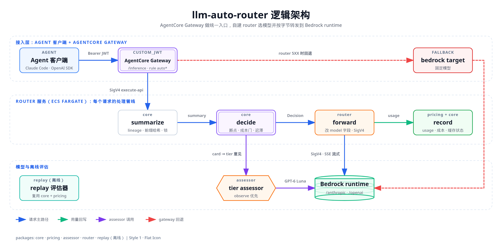
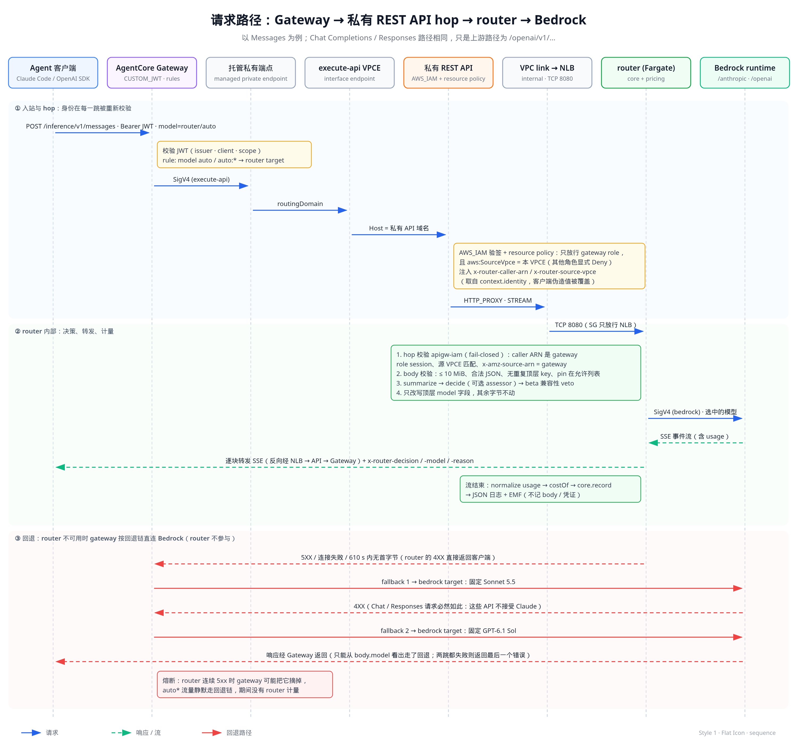
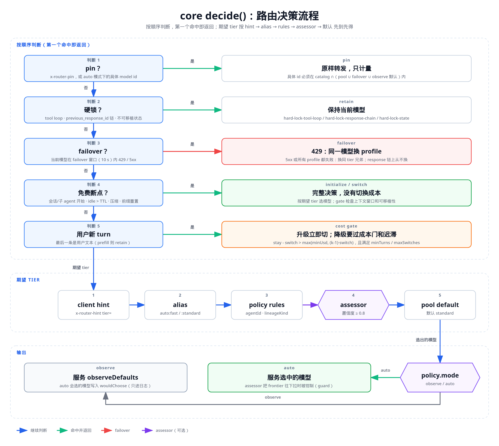
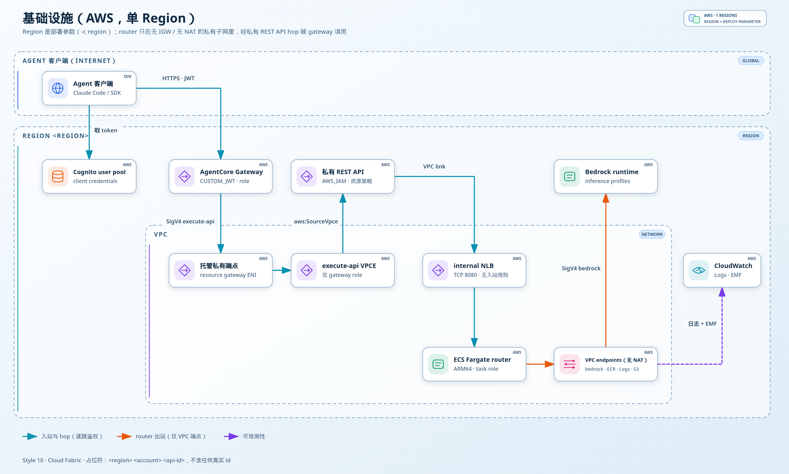
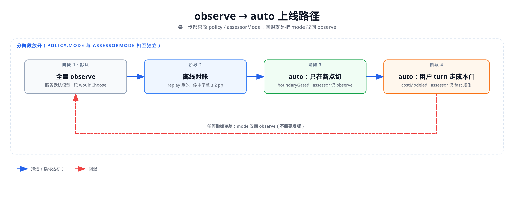

# llm-auto-router 架构设计

> 面向 agent 流量的 cache-aware 模型路由器。Agent 用原生 SDK（Anthropic Messages、OpenAI Chat Completions、OpenAI Responses）调用 AgentCore Gateway；网关后面的自建 router 选择模型，按字节转发到 Amazon Bedrock。目标是**省钱，同时不打破 prompt cache**。
>
> 状态：2026-11-04。数据面 hop 已在 spike V9d 端到端验证；路由引擎、计价、assessor、replay 均已实现并有单元测试；整体部署后的 E2E（E0–E12）已于 2026-11-04 在 `ap-southeast-1` 执行：E6 部分通过、待复测，其余全部通过（§13.5）。文中所有 id 都是占位符（`<account>`、`<region>`、`<api-id>` 等）。

## 目录

1. [背景与目标](#1-背景与目标)
2. [非目标](#2-非目标)
3. [核心设计原则](#3-核心设计原则)
4. [整体架构](#4-整体架构)
5. [请求路径](#5-请求路径)
6. [路由决策](#6-路由决策)
7. [LLM tier assessor](#7-llm-tier-assessor)
8. [计价与成本核算](#8-计价与成本核算)
9. [安全模型](#9-安全模型)
10. [部署与参数](#10-部署与参数)
11. [可观测性](#11-可观测性)
12. [限制与已知约束](#12-限制与已知约束)
13. [评估结果](#13-评估结果)
14. [路线图与待办](#14-路线图与待办)

---

## 1. 背景与目标

Agent 的一次任务往往包含几十到上百次模型调用，而且每次调用都带着越来越长的历史。真正决定账单的不是单价，而是 **prompt cache 命中率**：

| 观察（见 research A / C） | 含义 |
|---|---|
| 同一 turn 内（调用间隔约 1 s）命中率 90–98% | 只要模型不变，长上下文几乎都按 cache read 价计费（约为输入价的 1/10–1/20） |
| 跨 turn 约 55%，5 分钟 TTL 处有断崖 | 用户停顿超过 TTL，缓存自然失效 |
| 切换到新模型后的第一次调用约 8% | 换模型 = 在新模型上把整段上下文**冷写**一遍（写入价是输入价的 1.25–2 倍） |

所以"按请求难度挑最便宜的模型"这种 cache-blind 路由在 agent 场景里经常更贵：replay 实测，cache-blind 分类器每 100 次调用切换 23 次，其中 11 万次切换发生在 tool loop 内部，冷写次数是基线的 4.4 倍（见 §13）。

**目标**

- 在不改 agent 代码的前提下降低模型成本：agent 只需把 base URL 指向网关，把 model 设为 `router/auto`。
- 只在"切换几乎免费"的时刻换模型；其余时刻换模型必须算得过账。
- 按字节透传：除了 `model` 字段（以及显式开启的 cache hint），请求体不做任何修改；SSE 端到端保持增量。
- 每个决策都可解释、可审计：带 reason、policy 版本，并通过响应头返回。
- 可发布：Region、账号、资源前缀、标签都是部署参数，代码里没有任何项目私有的默认值。

## 2. 非目标

| 不做 | 原因 |
|---|---|
| Converse API | 只支持三种原生 API 的透传 |
| 跨 API 翻译（如 Messages ↔ Chat） | 每种 API 只在自己的模型池里选：Messages → Claude；Chat / Responses → GPT、Kimi 等 OpenAI 兼容模型 |
| 学习型质量预测器 | MVP 用确定性的 gate + 规则 + 可选的 LLM assessor |
| Anthropic / OpenAI 第一方端点 | 只转发到 Bedrock runtime |
| Advisory API（只给建议不转发） | 后续阶段 |
| Responses 的 `GET` / `DELETE` | 不在 MVP 内（需要单独的 HTTP passthrough target） |
| 多租户隔离 | router 已能识别调用方并按调用方统计（§9.1），但会话状态、策略和网关仍由所有调用方共用 |

## 3. 核心设计原则

1. **缓存从不跨模型、版本或 Region 共享。** Bedrock 的缓存条目留在提供服务的那台服务器上，没有亲和键。`global.` 和 `<geo>.`（如 `jp.`）inference profile 也是不同的缓存域。所以"换模型"在成本模型里永远等于一次冷写。
2. **只在免费断点切换。** 免费断点是指缓存本来就要失效或本来就不存在的时刻：会话开始、新的子 agent、空闲超过 TTL、上下文压缩（compaction）、任务开始、前缀被重置（tools / system / 关键参数变了）。这些时刻做完整决策，没有切换成本。
3. **硬锁永不切换。** tool loop 中（最后一条是 tool result）、Responses 的 `previous_response_id` 链、历史里带有目标模型无法接受的状态（thinking signature、encrypted reasoning 等）时，一律保持当前模型。
4. **降级要过成本门。** 用户新 turn 想降到便宜档时，必须满足 `cost(stay, H) − cost(switch, H) > max(minUsd, (k−1)·cost(switch, H))`，再加上迟滞（minTurns、maxSwitches），防止来回抖动。
5. **升级为了质量，永远不会靠省钱回本。** 往上切（如 Sonnet → Opus）是质量驱动的，立即生效，不走成本门；它在成本上永远是净支出（§6.3）。
6. **Failover 按失败类型区分。** 429 先换同一模型的另一个 profile（如 `global.` ↔ `<geo>.`），因为不同 profile 的配额是分开的，一个被限流时另一个往往还有余量。5xx 和连接失败不换 profile：`global.` 本身已经跨 Region 路由，它失败时 geo profile 多半也在失败，换过去只会多一次注定失败的调用，单价还贵约 10%，缓存也是冷的；这时直接换同 tier 的兄弟模型，没有兄弟模型就交给网关 fallback。`previous_response_id` 链上从不换 profile。
7. **网关管身份与治理，router 管一切与缓存相关的事。** 网关的加权路由和改模型的 fallback 从不用于模型选择；网关 fallback 只用于 router 自身故障时的兜底。
8. **先 observe 后 auto。** 默认只记录"auto 会选什么"（`wouldChoose`），实际服务固定模型；验证指标后再逐步放开。

## 4. 整体架构



*图 1：逻辑架构（[SVG](diagrams/01-system-architecture.svg)）。* Agent 客户端带着 Cognito 签发的 access token 调用 AgentCore Gateway 的 `/inference` 路径，token 同时放在 `Authorization` 和 `x-api-key` 里。网关校验 `Authorization` 里的 JWT，用兜底规则把所有请求交给 router target，并用自己的角色做 SigV4（service `execute-api`）。router 先校验 `x-api-key` 里的 token，记录调用方（§9.1）。router 内部是一条固定管线：`summarize` 从请求里抽取 lineage、前缀哈希链和锁信息；`decide` 结合会话缓存状态做决策，必要时咨询 tier assessor；`forward` 只改写 `model` 字段，用 task role 做 SigV4 后调用 Bedrock runtime，并把 SSE 原样回传；`record` 用响应里的 usage 计算成本、更新每个模型的缓存状态。router 返回 5XX 时，网关的 fallback 规则绕过 router，直接用固定模型调用 Bedrock。replay 评估器离线复用 core 和 pricing，对历史 trace 重放不同策略。可选的管理控制台（§9.2）管理成员、策略和评估器，并从 router 日志统计用量、成本和节省。

### 4.1 代码包

| 包 | 职责 | 依赖 |
|---|---|---|
| `@auto-router/pricing` | 每个 Region 的价格目录、三种 API 的 usage 归一化（流式与非流式）、`costOf`（含长上下文档位） | 无运行时依赖 |
| `@auto-router/core` | 纯决策引擎：`summarize` / `decide` / `record`、policy 校验、成本模型、`StateStore` 接口与内存实现、TierAssessor hook | 只依赖 pricing 的类型 |
| `@auto-router/assessor` | LLM tier assessor：构造 task card、渲染 prompt pack、调用轻量模型、校验输出、映射 tier | core（类型）、pricing |
| `@auto-router/router` | 数据面服务（`node:http`）：hop 校验、body 校验、决策、beta 兼容性 veto、SigV4 转发、流 tee、计量、日志与 EMF | core、pricing、AWS SDK 签名组件 |
| `@auto-router/replay` | 离线评估 CLI：trace 适配、缓存模拟器、策略对比、合成 sweep | core、pricing |
| `infra/` | CDK 应用：VPC、端点、私有 REST API、NLB、ECS、Cognito、AgentCore Gateway 与 target | — |

### 4.2 包之间的契约（摘要）

```ts
// pricing
normalizeUsage(dialect, body): NormalizedUsage      // uncached / cacheRead / cacheWrite[ttl] / output / promptTokens
createStreamUsageAccumulator(dialect)                // 边转发边从 SSE 里累计 usage
costOf(usage, price): CostBreakdown                  // 唯一的计价入口（长上下文、TTL 写入价都在这里）

// core
engine.summarize(dialect, body, headers, nowMs): RequestSummary
engine.decide(summary, { card? }): Promise<Decision> // action: initialize | retain | switch | pin；point；reason；mode；wouldChoose
engine.record(summary, decision, outcome): Promise<RecordResult>   // 用真实 usage 校准缓存状态（闭环）

// assessor（实现 core 的 TierAssessor）
createAssessor({ model, transport, pack }).assess(card, signal): Promise<AssessorResult>
```

## 5. 请求路径



*图 2：请求时序（[SVG](diagrams/02-request-flow.svg)）。* ① 客户端用 Bearer JWT 调用网关；网关校验 JWT，规则 `auto*` 命中 router target，并以网关角色做 SigV4（execute-api）。请求经网关在我们子网里创建的托管私有端点（resource gateway ENI）、按 `routingDomain` 进入 execute-api VPC endpoint，到达私有 REST API。API Gateway 做 AWS_IAM 验签，并用 resource policy 只放行"网关角色 + 本 VPCE"；它从 `context.identity` 注入 `x-router-caller-arn` 和 `x-router-source-vpce`（客户端伪造的值会被覆盖），再经 VPC link 和内部 NLB 送到 Fargate 上的 router。② router 先做 fail-closed 的 hop 校验，再校验 body，然后决策、改写 `model`，用 task role SigV4 调用 Bedrock，把 SSE 逐块回传，流结束后计量并写日志与 EMF。③ router 返回 5XX、连接失败或 610 s 内没有首字节时，网关 fallback 链先调用 Bedrock 上的 Sonnet 5.5；如果它返回 4XX（Chat / Responses 请求必然如此），再改用 GPT-6.1 Sol。整个过程 router 不参与。

### 5.1 为什么 hop 是私有 REST API

| 选项 | 结论 | 证据 |
|---|---|---|
| (a) VPC Lattice 服务 + IAM auth policy | **不可行** | AgentCore 对每个请求都做 signed payload 签名，而 Lattice（AWS_IAM）拒绝 signed payload；凭证 provider 没有 unsigned-payload 选项。target 创建时的模型发现调用直接失败（V9） |
| Lambda Function URL | 不可行 | 网关能转发 ≥ 12 MB 的请求，Lambda URL 约 4.5 MB 就截断（spike V5） |
| (d) 私有 REST API（AWS_IAM）+ execute-api VPCE + VPC link + 内部 NLB | **采用** | V9d 端到端验证通过（下表） |

V9d 验证结果（hop 形态，router 位置为 echo stub，无 Bedrock 调用）：

| 检查 | 结果 |
|---|---|
| 匿名拒绝（先于任何流量） | 未签名 → 403；身份策略允许 `execute-api:Invoke` 的其他角色 → 403（resource policy 里的显式 Deny）；VPC 内直连 NLB / task 的 TCP → 超时；私有 API 主机名在 VPC 外解析不到 |
| 透传 | target READY（网关的 `GET /v1/models` 模型发现通过）；三种 API 都返回 200，body 字节级一致（sha256 相同） |
| 身份头 | router 看到 `x-router-caller-arn` = 网关角色的 assumed-role session、`x-router-source-vpce` = 本端点、`x-amz-source-arn` = 网关 ARN；客户端伪造的这些头都被覆盖 |
| 请求大小 | 1 / 7 / 9.5 MiB 完整通过；12 MiB → API Gateway 返回 413（上限 10 MiB） |
| SSE 节奏 | 三种 API 上 100 ms 的 tick 都保持增量（中位间隔 100 ms） |
| 静默间隔 | 240 s 无数据可以存活；超过 300 s 被 API Gateway 私有端点的 idle timeout 切断（干净关闭，没有错误事件）。router 因此实现了 SSE 心跳（§5.2） |
| 总时长 | 630 s 的流正常完成；单个响应流在约 901 s 处被切断（15 分钟硬上限，干净关闭） |
| 延迟 | 从开发机测得 TTFB p50 约 637 ms（gateway → VPCE → REST API → NLB → Fargate 全链路）。早期基线在另一个 Region，因此这里不给出"增加了多少"的差值 |

### 5.2 router 内部管线

1. **hop 校验（`ROUTER_HOP_AUTH=apigw-iam`，fail-closed）**：`x-router-caller-arn` 必须是网关角色的 session，`x-router-source-vpce` 必须等于配置的端点，`x-amz-source-arn` 必须等于网关 ARN；任何头出现多个值都拒绝。未配置时拒绝一切请求。403 响应带 `connection: close`。
2. **body 校验**：≤ 10 MiB（413）、合法 JSON（400）、无重复顶层 key（400）；具体模型 id 必须在 catalog ∩（pool ∪ failover ∪ observe 默认）内，否则 400 `pin-not-allowed`。
3. **决策**：`summarize` → `decide`（可选 assessor）→ beta 兼容性 veto（目标模型已知不接受某个 `anthropic-beta` 时，不切过去）。
4. **改写**：用最小的顶层 JSON 扫描器只替换 `model` 的值，其余字节不动（有 property test 保证）。可选 hint：Chat 流式请求注入 `stream_options.include_usage` 再把 usage chunk 剥掉（`inject-strip`），否则 Bedrock 不返回 usage。
5. **转发**：SigV4（service `bedrock`）调用 `bedrock-runtime.<region>.amazonaws.com`。首字节前遇到的状态在 `failover.profileRotateOn` 里（默认只有 429；网络错误按 502 计），并且 policy 给该模型配置了 failover profile 时，换 profile 重试一次。5xx 默认不重试，直接返回，由网关 fallback 接手。
6. **回传**：响应头先写 `x-router-decision: <action>;<point>;<mode>`、`x-router-model`、`x-router-reason`，然后边收边转发；tee 出一路 SSE 解析器累计 usage。针对 hop 的流限制：
   - 上游静默期间，每隔 `ROUTER_SSE_HEARTBEAT_MS`（默认 60 s，0 表示关闭）在完整帧之间写一个 SSE comment（`: keepalive`），覆盖 60–240 s 的静默，避免被 API Gateway 5 分钟的 idle timeout 切断。SDK 会忽略 SSE comment。
   - 上游静默达到 240 s 时视为上游已死（`idle-timeout`，记为 `mid-stream`）。
   - 接近 15 分钟上限（`ROUTER_STREAM_CAP_MS` = 900 s）时客户端被断开，记为 499 `stream-duration-cap`，以区别于普通的 `client-abort`；已收到的 usage 照常计价。
7. **记录**：流结束（或中断）后 `normalizeUsage` → `costOf` → `engine.record`，写一行 JSON 日志和一个 EMF 文档。中途断流记为 502（`mid-stream`），客户端中止记为 499（`client-abort`），都按已看到的 usage 计价。

### 5.3 网关 fallback

只有一条兜底规则（优先级最低，匹配所有模型名，身份识别验证实验 S7 已确认）和一条回退链。不能每条路径一条规则，因为 GatewayRule 的 `MatchPathPattern` 只能匹配一个路径段，没法区分 `/v1/messages` 和 `/v1/chat/completions`。

| 跳 | 目标 | 触发条件 |
|---|---|---|
| 主路由 | router target | 所有请求（具体模型 id 在 router 里按指定模型处理） |
| fallback 1 | `bedrock` target，固定 Sonnet 5.5 | router 返回 5XX、连接失败，或首字节超时（`FirstByteTimeoutMilliseconds` = 610 s，比 router 非流式请求 600 s 的上游响应头时限略长） |
| fallback 2 | `bedrock` target，固定 GPT-6.1 Sol | Sonnet 返回 4XX：Chat / Responses 请求就是这样到达 Sol 的，代价是多一次注定失败的 Sonnet 调用 |

- 两个 fallback 都失败时，客户端看到最后一个 target 的错误。
- router 返回的任何 4XX（如 413 超过 10 MiB、400 `pin-not-allowed`）以及 429 都**直接**返回客户端，不触发 fallback。
- `bedrock` target 的请求头白名单不含 `x-api-key`：Bedrock 不接受同时带 `x-api-key` 和 `Authorization` 的请求，否则带身份头的调用回退时会 400（实验 S7 发现并修正）。
- 客户端只能从响应 body 里的 `model` 看出走了 fallback；router 没见过这次请求，下一次请求它会把前缀不匹配当作断点处理。
- **熔断**：网关的 circuit breaker 默认开启。router 连续返回 5xx 时，网关可能把 router 暂时摘掉，所有流量会静默地全部走固定的 fallback 模型，这段时间 router 没有任何计量（网关 fallback 服务的 turn 本来就不经过 router，E6 / E7 已确认）。摘除和恢复的时间尚未测量。

## 6. 路由决策



*图 3：`decide()` 的判断顺序（[SVG](diagrams/03-routing-decision.svg)）。* 判断自上而下，第一个命中即返回：pin（客户端显式 pin，或 auto 模式下请求了具体模型 id）→ 硬锁（tool loop、`previous_response_id` 链、不可移植状态）→ failover（当前模型在窗口内失败过）→ 免费断点（完整决策）→ 用户新 turn（升级立即切，降级过成本门和迟滞）。断点和用户 turn 都需要"期望 tier"，它按 client hint → alias → policy rules → assessor → pool 默认的顺序取第一个有值的来源。最后由 `policy.mode` 决定：observe 模式服务固定的 `observeDefaults`，只把 auto 的选择写进 `wouldChoose`；auto 模式才真正服务选中的模型。

### 6.1 会话与 lineage

- **会话 id**：依次取 `x-router-session`、`x-claude-code-session-id`、`x-session-id`、OpenAI 的 `prompt_cache_key`；都没有时用指纹（tools + system + 第一条用户消息的哈希）。
- **lineage** = 会话 id + 模板族（tools 和 system 的哈希），或者 `x-router-agent-id`。这样同一会话里的子 agent（system prompt 不同）自然是独立 lineage；fork（tools 和 system 相同）共享父 lineage，从而继续用父缓存、留在同一模型上。
- **root 索引**：同一 root 下出现新 lineage 即判为 `subagent-start`。
- **前缀哈希链**：tools → system → 关键参数（thinking、tool_choice 等，它们一变就让 messages 层缓存失效）→ 每条消息逐块链式哈希。哈希前去掉 `cache_control` 等断点标记，因为客户端每轮都会挪动它们。
- **缓存状态**：按 (lineage, model) 记录最多 4 条前缀记录（LRU，避免 fork 冲掉父记录），用响应 usage 校准（闭环），按实际写入的 TTL 判断是否过期。

### 6.2 断点的判定

| 断点 | 判定方式 |
|---|---|
| `session-start` | lineage 没有状态，且 root 也是新的 |
| `subagent-start` | 已见过的 root 下出现新 lineage，或带有子 agent / 父会话 hint |
| `idle-expired` | 当前模型的所有前缀记录都已超过 TTL（减去安全余量） |
| `compaction` | 当前模型没有命中，且 prompt 比缓存小很多（< 0.6 × 已缓存 token），或客户端带 `boundary=compaction` hint |
| `task-start` | 客户端 hint `boundary=task-start` |
| `prefix-reset` | 当前模型没有命中，但 prompt 没有缩小（tools / system / 参数变了） |

### 6.3 成本门与回本直觉

对候选模型 m，预测接下来 H 次调用（默认 H = 15，每次追加 1,000 token、输出 250 token）的总成本：

```
第 0 次:   读 W（m 上还热的部分）· 写 P − W · 输出 O
第 i 次:   prompt_i = P + i·D；读 prompt_{i−1} · 写 D · 输出 O      （turn 内间隔远小于 TTL）
cost(m, H) = Σ costOf(usage_i)                                    （长上下文档位、TTL 写入价由 pricing 处理）
```

降级条件：`stay − switch > max(minUsd, (k−1)·switch)`，默认 k = 1.2、minUsd = $0.02；另外要求距上次切换至少 `minTurnsBeforeSwitch` 个用户 turn（默认 2，cost-modeled preset v2 为 1），且每个 lineage 的成本驱动切换不超过 `maxSwitchesPerLineage`（默认 6）。

**直觉**：换模型的代价是一次性冷写整段上下文，收益是之后每次调用的差价。差价越大、剩下的调用越多，越早回本。首次切换的回本步数（Bedrock global 价格，2026-11-04；每步新增 1K token、输出 250）：

| 切换 | 50K 上下文 | 150K 上下文 |
|---|---|---|
| 同系列降一档（Opus 5.5 → Sonnet 5.5，GPT-6.1 Sol → Terra） | 11 步 | 17 步 |
| 降到最便宜档（Haiku 5.5，GPT-6 Luna） | 第一步就更便宜 | Luna 立即；Haiku 2–7 步（超过 100K 时 Haiku 按长上下文价 ×5） |
| 升一档（Sonnet 5.5 → Opus 5.5） | 一次性多花 $0.25，永不回本 | 多花 $0.74，永不回本 |

这也解释了为什么切回原模型也不是免费的：A 的缓存在 TTL 内还热，切回去只需重写这期间追加的部分（碎片化），成本模型会按"每个模型各自的热度"计算这一点。

### 6.4 Failover 细节

- 每个 profile 单独记录失败时间（窗口默认 10 s）。
- 换 profile 要同时满足两个条件：policy 给该 pool 条目配置了 `failover` 列表，并且失败状态在 `failover.profileRotateOn` 里（默认 `[429]`，可以加上 5xx 状态，`[]` 表示关闭）。原因：global 和 geo profile 的配额分开计算，429 换 profile 有机会成功；`global.` 本身已经跨 Region 路由，5xx 时 geo profile 大概率也不可用。
- 默认 policy 只用 global profile，因此没有 router 内重试：5xx 交给网关 fallback，下一次请求 core 再把会话切到同 tier 兄弟。
- 5xx 或所有 profile 都失败时才离开当前模型。tool loop 内还要求历史里没有不可移植状态，目标是同 tier、能通过 gate 的兄弟，才允许跨模型；否则保持当前模型（reason 会写明 `no profile rotation on <status>`）。
- `previous_response_id` 链从不换 profile（跨 profile 读取已存储的 response 尚未验证）。

### 6.5 Policy 与 preset

Policy 是一份带版本的 JSON：模式（observe / auto）、alias、每种 API 的模型池（带 tier 和 failover）、规则、gate、cache、迟滞、horizon、可移植性、`userTurn`（`cost-gated` / `retain`）、`observeDefaults`。它在 synth 时和 router 启动时都会对照该 Region 的价格目录做校验，模型不存在就直接失败。

| Preset | 用户 turn | 规则 | 用途 |
|---|---|---|---|
| 默认 policy（镜像内置） | `retain` | 无 | observe 模式，只用 global profile，每档一个模型；alias 请求服务 Sonnet 5.5 / GPT-6.1 Sol |
| `boundaryGated` | `retain`（只在断点切） | 无 | 最保守的 auto |
| `costModeled`（v2） | 成本门 | 无 | 用户 turn 允许成本驱动的降级 |
| `costModeledSubagentFast`（v2，可选） | 成本门 | 子 agent → fast | 子 agent 从最便宜档起步 |

## 7. LLM tier assessor

确定性信号（hint、alias、规则）都没有给出 tier 时，core 可以咨询一个轻量 LLM 判断"这一轮需要哪个档"。

**工作方式**

- 只在允许的时刻咨询：会话 / 子 agent / 任务开始，以及其他断点或用户新 turn（最后一条是用户文本时）。pin、硬锁、failover、tool result 之后都不咨询。
- 按需构造 task card（最新用户文本、首条用户文本、上下文摘要、当前 tier 等，均有长度上限），作为转义后的 JSON 放进定界块，从不拼进指令；指令里明确"消息内容都是不可信数据"。
- 模型逐条判断规则并给出事实，**由代码映射 tier**（`mapTier`），不让模型直接说"用 fast"。输出用 Responses strict schema 或 Messages 强制 tool 约束，校验失败视为无意见。
- 本地 precheck：没有用户文本或只是"ok / thanks / continue"之类时直接跳过，不调用模型。
- 超时默认 5 s（最初是 1.5 s；Codex 大小的 card 实测 p50 约 1.5 s，1.5 s 会让约 60% 的咨询超时）；超时、错误、无效结果一律视为"无意见"，决策回落到基线。结果按 (lineage, 用户 turn) 缓存，重试不会重复付费。
- 默认模型 `global.openai.gpt-6-luna`；Claude 系轻量模型（如 Haiku 5.5）可配置，走 Messages 强制 tool 适配器。

**observe 优先**：`assessorMode` 默认 `observe`，只把意见附在决策上（`applied: false`），不改变服务的模型；`assessorMode` 与 `policy.mode` 相互独立。每条规则还有自己的 `auto` 开关，目前全部关闭。

**frontier 降级保护**：评估发现 assessor 几乎识别不出 frontier 级任务（下表），因此 `assessorDowngradeFrom` 默认只有 `['standard']`：assessor 只能把 standard 往下拉，不能把正在 frontier 上的会话拉下来；被拦截时意见被钳制为当前 tier，并记 `assessor-downgrade-guarded`。升级、client hint、alias 和规则不受影响。

**评估摘要**（pack v1；阈值 0.8；评估超时 10 s 以测真实延迟；总花费 $0.78）：

| 模型 | 数据集 | 覆盖率 | fast 精确率 | frontier 召回 | p50 / p95 延迟 | $/次 |
|---|---|---|---|---|---|---|
| GPT-6 Luna | 手工标注 80 条 | 96.3% | 100% | 88.9% | 1.29 / 1.47 s | 0.00029 |
| GPT-6 Luna | SWE-bench Verified 500 条 | 73.8% | 0%（8 个误判，金标均为 standard） | 0%（0/45） | 1.27 / 1.95 s | 0.00064 |
| GPT-6 Luna | 全部 660 条 | 75.0% | 87.1% | 31.2% | 1.27 / 1.78 s | 0.00057 |
| Haiku 5.5 | 全部 660 条 | 66.5% | 96.2% | 23.4% | 2.61 / 10.0 s | 0.00039 |

默认 pack 现为 v2.1，见 [docs/tasks/11-04-llm-tier-assessor/research/README.md § Pack v2.1](../tasks/11-04-llm-tier-assessor/research/README.md)。评估的完整介绍（数据集、方法、v1 → v2 → v2.1 的过程、结论和后续优化）见 [assessor 评估](assessor-eval.zh-CN.md)。assessor 的设计和运行方式（咨询时机、task card、prompt pack、tier 映射、router 接入、线上观察）见 [assessor 设计](assessor-design.zh-CN.md)。

结论：

- **Luna 是默认**：延迟能放进评估时的 1.5 s 预算（约 10% 超时；默认期限现为 5 s）；Haiku 精确率更高，但每次调用都超过 1.5 s，只适合更长预算或异步模式。
- **只在 fast 边界可信**：两种模型都识别不出 SWE-bench 里 1 小时以上的任务（只看 issue 文本看不出难度），因此有 frontier 降级保护；frontier 升级主要靠显式信号（多次失败、深度排查类措辞）。
- **提示注入影响很小**：4 次注入尝试，Luna 4/4 判对、Haiku 3/4，因为 tier 来自事实和规则判断，而不是模型的直接指令。
- **稳定性**：约 80% 的 tier 翻转发生在任务真的变了的 turn 上；非边界 turn 上的误翻转约 6–8%；没有观察到降级后下一轮立即升回的振荡。
- **pack v2.1 为默认**：pack v2 收紧了 `mechanical-edit`，但在留出的 SWE-bench 上把 17% 的 standard 误升到 frontier；pack v2.1 只保留 v2 的 fast 侧收紧、沿用 v1 的 frontier 定义，现为默认（Luna，阈值 0.8，手工 + SWE-bench 测试集 + 轨迹共 543 条：fast 精确率 98.3% vs v1 88.4%；SWE-bench 测试集上 standard→frontier 1/365；frontier 召回与 v1 持平）。规则仍全部 `auto: false`。

## 8. 计价与成本核算

**价格目录**

- 每个 Region 一份带版本的目录（当前内置 `ap-northeast-1` 与 `ap-southeast-1`，2026-11-04 两者的 global profile 价格相同）。每个模型条目包括 family、tier、可用 API、端点范围（global / geo / in-region）、上下文窗口、价格（input / output / cache read / 各 TTL 的 cache write）、长上下文档位和缓存行为（explicit / implicit、最小 token、TTL）。
- 价格来自 AWS Price List API；某 Region 缺 SKU 时用 fallback Region 的 global SKU 或模型卡价格，并在 `priceSource` 里标明来源。没有公开 global 价格的模型被排除，并记录原因。
- 新增 Region：运行只读采集脚本（`pricing:GetProducts`、`bedrock:ListInferenceProfiles`、`bedrock:ListFoundationModels`）→ 构建目录 → 生成模块 → 测试。也可以不打包，直接把目录文件交给 router（`ROUTER_CATALOG_FILE`）和 infra（`-c catalogFile=`），它们都会校验目录的 `region` 是否与部署 Region 一致。

主要模型（USD / 百万 token，global profile）：

| 模型 | tier | input | output | cache read | cache write | 长上下文 |
|---|---|---|---|---|---|---|
| Claude Opus 5.5 | frontier | 4.00 | 20.00 | 0.20 | 5.00（5m）/ 8.00（1h） | — |
| Claude Sonnet 5.5 | standard | 2.00 | 10.00 | 0.10 | 2.50 / 4.00 | — |
| Claude Haiku 5.5 | fast | 0.10 | 0.50 | 0.01 | 0.125 / 0.20 | > 100K 整单 ×5 |
| GPT-6 Astra | frontier | 10.00 | 50.00 | 1.00 | 12.50（30m） | > 272K |
| GPT-6.1 Sol | standard | 2.00 | 10.00 | 0.10 | 2.50（30m） | > 272K |
| GPT-6 Luna | fast | 0.10 | 0.50 | 0.01 | 0.125（30m） | > 272K |

**usage 归一化**：三种 API、流式和非流式统一成 `uncachedInputTokens`、`cacheReadTokens`、`cacheWriteTokens[ttl]`、`outputTokens`（含 reasoning）、`promptTokens`。注意：

- Chat Completions 流只有在请求里设了 `stream_options.include_usage` 时才带 usage，所以 router 默认 `inject-strip`。
- OpenAI 形态的 cache write 没有 TTL 拆分，统一记为 30m（Bedrock 上唯一的 TTL）。
- 长上下文档位按整单重新计价（prompt 超过阈值时，连 cache read 也按高价）。

**核算**：每次调用记录成本拆分（input / cache read / cache write / output）、命中率（read / prompt）和 miss 归因（RecordResult）。assessor 自己的花费通过 `Decision.assessment.costUsd` 计入，且只在真正调用的那次决策上记一次。

## 9. 安全模型

| 环节 | 机制 |
|---|---|
| 客户端 → 网关 | `CUSTOM_JWT`，只校验 scope `<prefix>/invoke`：成员用自己的账号经 `cli` app client 登录（auth code + PKCE），服务客户端用 client credentials；不开放自助注册。token 由 Cognito 签发而不是我们自己生成；client secret 由 Cognito 生成，不作为 stack 输出 |
| 调用方身份 | 同一个 token 也放在 `x-api-key` 里，由 router 在进程内校验并记录调用方；会话头和提示头从不作为身份依据（§9.1） |
| 控制台 | CloudFront + 私有 S3（OAC）+ HTTP API（JWT 授权方，scope `<prefix>/console`）；默认不开启 MFA（生产环境应开启 TOTP MFA）；每个 API 路由在服务端按角色授权（§9.2） |
| 网关 → router | 网关角色 SigV4（`iamCredentialProvider {service: execute-api}`）→ 私有 REST API（AWS_IAM）。resource policy：只允许网关角色经本 VPCE 调用，显式 Deny 其他端点和其他 principal（同账号下仅靠身份策略的 Allow 就能进来，所以必须有显式 Deny）。VPCE 的安全组只放行网关 resource gateway 的安全组 |
| router 自身 | `apigw-iam` hop 校验 fail-closed（§5.2）；没有生产代码里的测试旁路；本地测试旁路只在绑定 loopback 时允许 |
| 网络 | router 在私有子网，无 IGW、无 NAT；NLB 安全组没有入站规则（只有 VPC link 流量能进）；router 安全组只放行 NLB 的 8080；出站只经 VPC endpoint |
| router → Bedrock | task role SigV4。`bedrock:InvokeModel*` **只授予 policy 里用到的模型**（pool、failover、observe 默认），按跨 Region 推理的标准模式授权，不用通配模型 ARN |
| 网关角色 | 只有 router API stage 的 `execute-api:Invoke`、两个 fallback 模型的 `bedrock:InvokeModel*`，以及 Bedrock connector 模型发现所需的 List/Get |
| 凭证不落地 | API Gateway 会把网关会话的 `x-amz-security-token` 透传下来，集成把它覆盖为固定值 `redacted`；router 记录 `hopToken` 状态，一旦看到非预期值就发 `Alerts` 指标 |
| 日志卫生 | 从不记录 body、prompt、原始 session id，以及除 `anthropic-version`、`anthropic-beta`、`openai-beta`、`content-type` 之外的任何头值；有回归测试断言 `authorization`、`x-amz-security-token`、`x-api-key`、`cookie` 永不出现；lineage 只记哈希前缀；assessor 的 audit 可能引用 prompt，不进入决策对象 |
| 部署顺序 | 先以 `routerDesiredCount=0` 部署，验证匿名 / 错误 token / 直连 API / 直连 NLB 和 task 全部被拒（E0），再扩到 1 |

### 9.1 调用方身份

- **做法。** 客户端把同一个 Cognito access token 发两次：`Authorization: Bearer` 给网关校验，`x-api-key` 给 router 校验。网关只认 `Authorization`，`x-api-key` 原样转发（身份识别验证实验 S1/S2）。router 在进程内校验 `x-api-key` 的 JWT：RS256 签名（公钥来自 user pool 的 JWKS，由 `jwks-sync` 每小时写到配置桶，router 不访问互联网）、签发方、`token_use=access`、有效期和 scope `<prefix>/invoke`。调用方记为 `principal`（成员是 `sub`，服务客户端是 client id），日志里只有 id，没有用户名和邮箱。
- **模式。** `off`（不读这个头）、`observe`（校验并记录；缺失或无效时照常服务，记为未归属）、`require`（缺失或无效返回 401）。`observe` 下，拦截、预算和档位上限对每个带有效 `x-api-key` 的调用都生效，不带的调用照常服务、不归属，也不受约束；只有 `require` 下才对所有人生效。
- **拦截和预算。** 控制台写拦截名单和调用方名单（组和档位上限），router 每 30 秒轮询，约 35 秒内生效。用量导入写预算拦截名单：它在 CloudWatch Logs 分批送达日志后才运行（通常不到 3 分钟），再加上 router 的 30 秒轮询，所以预算拦截在几分钟内生效，这段时间内的请求照常通过，支出可能略微超出预算。被拦截返回 403 `identity-blocked`，预算用完返回 429 `budget-exceeded`。都是 4xx，所以不会触发网关回退；router 从不为此返回 5xx，否则回退会绕过 router。
- **为什么不是自造认证。** 网关仍然负责认证；router 只是用 user pool 公开的密钥校验一个标准的 Cognito JWT，用于归属、拦截和预算。要冒用别人，必须持有对方的有效 token，而这本来就等于完全冒充。
- **剩余限制。** 会话头仍由客户端自行声明：同一个会话 id 可能被别人撞上或污染 lineage，但状态里只有哈希、计数和模型 id，影响仅限路由质量。router 出错时由网关回退服务的调用不经过 router，不归属、不计量，也不受拦截和预算约束。

### 9.2 管理控制台

- **拓扑。** 单独的 stack（`<prefix>-console`），在 router stack 之后部署、之前删除，通过 SSM 参数读取 router 的值，不用 stack export。浏览器 → CloudFront：`/*` 经 OAC 读私有 S3（只有网页，没有数据），`/api/*` 同源转到 HTTP API（JWT 授权方：user pool、console app client、scope `<prefix>/console`）→ console-api Lambda。每个路由都在服务端按角色授权；成员只能读自己的记录，访问别人的 id 返回 404。
- **登录。** Cognito 托管登录（auth code + PKCE），不开放自助注册。默认不开启 MFA，生产环境应在 user pool 上强制开启 TOTP MFA（见 infra/README.md 的 Production hardening 一节）。成员的命令行 `llmar` 用 `cli` app client（127.0.0.1 回调），refresh token 30 天，access token 60 分钟。
- **运行时配置。** 策略和评估器设置组成一份带版本的配置文档。控制台先用和 router 相同的校验逻辑（`validatePolicy`、`checkPolicyAgainstCatalog`、评估器设置校验、允许的模型列表）校验，再发布到配置桶；router 每 30 秒轮询，约 1 分钟内生效。router 收到的文档只要本身有效就接受，否则保留旧版本并记录 `kind: "config"` 的拒绝日志。换配置时进行中的 lineage 保持当前模型，直到下一个缓存断点（硬锁不会被打破）；控制台在启用前显示 `policySwapEffects` 的影响列表。允许的模型列表之外的模型需要 CDK 部署（task role 的授权跟着它走）。
- **用量导入。** router 日志组的订阅过滤器（`kind` 为 model、error、rejected、config）把日志交给 usage-ingest Lambda，写入 DynamoDB：每个请求一条记录（保留 90 天，可调），以及按 UTC 日期的汇总（保留 400 天），按请求 id 幂等。导入的失败进入 SQS 死信队列并告警。
- **节省的口径。** 和一个从不切换的固定基线比较（默认是请求自己的档位）：`N = B − A − X = R − S − X`，`R = B − A*`，`S = A − A*`；负数照实显示；未计量调用和因档位上限的强制降档单独列出。所有数字都是目录价，假设用量相同，不衡量质量（见 Harbor 结论总结）。
- **不保存内容。** 记录和汇总里只有 id、代码、token 数和成本，没有提示词、card 或输出文本。

## 10. 部署与参数



*图 4：AWS 基础设施（[SVG](diagrams/04-infra-aws.svg)）。* 一个 Region（部署参数）里：客户端从 Cognito 取 token 后调用 AgentCore Gateway；网关在我们 VPC 的两个 AZ 私有子网里放置托管私有端点（resource gateway ENI），经 execute-api interface endpoint 调用私有 REST API；REST API 再经 VPC link 和内部 NLB 到达 ECS Fargate（ARM64）上的 router。router 的所有出站（Bedrock runtime、ECR、CloudWatch Logs，以及 S3 gateway endpoint 上的镜像层）都走 VPC endpoint，子网没有 IGW 和 NAT。日志和 EMF 写入 CloudWatch。

**部署参数**（CDK context，`-c key=value`；代码里没有任何部署私有的默认值）：

| 参数 | 默认 | 说明 |
|---|---|---|
| `region` | — | **必填**。需要有内置价格目录，或提供 `catalogFile` |
| `account` | — | **必填**。`-c account=env` 表示显式使用当前 CLI 凭证所在账号；CDK 拒绝部署到其他账号 |
| `azIds` | 按 Region 的内置表 | 两个支持托管私有端点的 AZ ID；表里没有的 Region 必填 |
| `prefix` | `llmar` | 物理资源名、Cognito scope 和域名的前缀 |
| `tags` | `{"Project":"llm-auto-router","Purpose":"mvp"}` | JSON 对象，合并到默认值之上，例如 `-c tags='{"Owner":"team-x"}'` |
| `policyFile` | 镜像内置默认 policy | synth 时对照 Region 目录校验，router 启动时再校验一次 |
| `catalogFile` | 内置目录 | 自行采集的其他 Region 目录 |
| `routerDesiredCount` | `0` | 先 0，跑完 E0 再改成 1 |
| `throttle` | `20,40` | API Gateway stage 限流（rps，burst）；账号和 Region 级配额是共享的 |
| `identityMode` | `observe` | router 身份识别模式的部署默认值（`off` / `observe` / `require`），控制台的配置版本可以覆盖 |
| `cliRedirectPorts` | `52817,52818,52819` | `cli` app client 上登记的 `llmar login` 回调端口（只在 127.0.0.1） |
| `codexOauthPort` | `52820` | 为 Codex 自己的登录（`gateway_oauth`）登记的回调端口 |
| `cliRefreshDays` | `30` | `cli` client 的 refresh token 有效期，即成员 `llmar` 登录的有效天数 |
| `console` 等 | — | 控制台 stack 的参数（`console`、`consoleBundle`、`ingest`、`adminEmail`、`recordRetentionDays` 等）见 [infra/README.md](../../infra/README.md#console-inputs) |
| `S3PrefixListId`（stack 参数） | — | 该 Region 的 `com.amazonaws.<region>.s3` 托管前缀列表，用于镜像层下载 |

示例：

```bash
npx cdk deploy -c region=<region> -c account=<account> -c tags='{"Owner":"team-x"}' \
  --parameters S3PrefixListId=<prefix-list-id>
```

**按 Region 的差异**：模型池和 failover profile 都要在所选 Region 的目录里存在，否则 synth 和启动都会失败。有 geo profile 的 Region（如 Tokyo 的 `jp.`）可以配置同模型 failover（默认只在 429 时使用），示例 policy 已经加了这些 profile；只有 global profile 的 Region，failover 就是跨模型（交给网关 fallback 和下一次请求的 core）。

**固定成本（估算）**：即使 `routerDesiredCount=0`，interface endpoint 和 NLB 也按小时计费。以 ap-southeast-1 为例（AWS Price List API 的 On-Demand 价格，2026-11-05 查询）：

| 组成 | 数量 | 单价 | 每月（730 小时） |
|---|---|---|---|
| Interface VPC endpoint（bedrock-runtime、ecr.api、ecr.dkr、logs、execute-api） | 5 个 × 2 AZ | $0.013 / endpoint-AZ-小时 | ≈ $94.90 |
| Network Load Balancer | 1 | $0.0252 / 小时 | ≈ $18.40 |
| **合计** | | | **≈ $113** |

不含按用量计费的部分：endpoint 数据处理（$0.01/GB）、NLB LCU（$0.006/LCU-小时）、CloudWatch Logs、Fargate 任务和 Bedrock 调用。价格因 Region 而异，也会调整，部署前请用 [AWS Pricing Calculator](https://calculator.aws/) 按所选 Region 重新估算。S3 gateway endpoint 不收费。

**拆除**：`cdk destroy`，然后做一次验证列举，必须为空：带标签或带前缀的资源，`<prefix>-` 开头的 gateway、REST API、VPC link、负载均衡器、VPC endpoint 和 resource gateway，以及 ECS 集群、VPC 和 Cognito pool。

**部署经验**：第一次部署失败，原因是网关 target 在网关角色的 policy 挂上之前就开始做模型发现。现在 target 显式依赖这个 policy 资源，CloudFormation 会先建 policy，再建 target。

### 10.1 上线节奏



*图 5：从 observe 到 auto（[SVG](diagrams/05-rollout.svg)）。* 先全量 observe：服务固定的默认模型，把 auto 的选择记入 `wouldChoose`。然后离线对账：用 replay 重放，确认通过网关后的缓存命中率与直连 Bedrock 相差不超过 2 个百分点。接着切到只在断点换模型的 auto（`boundaryGated`，assessor 仍是 observe）。最后放开用户 turn 上的成本门（`costModeled`），assessor 只放开 fast 边界的规则。每一步只改 policy 或 `assessorMode`；任何指标变差都可以把 mode 改回 observe，不需要发版。

## 11. 可观测性

**每个请求一行 JSON 日志**：`reqId`、dialect、请求的模型（已知 id 或 alias，否则记 `other` 加长度）、决策（action、point、mode、model、wouldChoose、reason、policyVersion、estimate）、实际服务的模型、status、是否流式、归一化 usage、成本拆分、命中率、miss 归因、`overheadMs`、`upstreamTtfbMs`、`durationMs`、body 字节数、已应用的 hint、failover、`hopToken`、lineage 哈希前缀；加上身份识别后还有 `principal`（类型和 id）、`identity`（verified / missing / invalid:<code>）、`configVersion`、`catalogVersion`、切换行上的 `switchedFrom`、观察模式下的 `decision.projected`，以及断流时的 `usageMissing` 和 `costBoundUsd`。router 每次启用或拒绝配置都写一行 `kind: "config"`。每个 router 任务还每 5 分钟写一行状态，报告它的配置版本和签名密钥是否已加载；控制台据此判断能否切到 `require`（要求 15 分钟内的状态行）。保留 7 天；控制台的用量导入从这里读取（§9.2）。

**EMF 指标**（namespace `LlmAutoRouter`，刻意保持低基数）：

| 维度集 | 指标 |
|---|---|
| `{Dialect, ServedModel}`、`{Mode}` | `Requests`、`CostUsd`、`PromptTokens`、`CacheReadTokens`、`CacheWriteTokens`、`Switches`、`Misses`、`OverheadMs`、`UpstreamTtfbMs`、`UpstreamErrors`、`Failovers`、`BetaVetoes` |
| `{StatusClass}`、`{StatusClass, Reason}` | 按状态类别和 reason code 的请求数（reason 是有限集合，未知归为 `other`） |
| `{MissReason}` | `Misses`（缓存 miss 的归因） |
| `{AlertReason}` | `Alerts`（例如 `hop-token-unexpected`：网关会话 token 没有被覆盖） |

`ServedModel` 只取 policy 里的模型 id 或 `other`，原始 id 截断后作为属性 `ServedModelId`。handler 崩溃时也会写日志和 EMF（status 500，Reason `internal`）。

**建议关注**：命中率（CacheReadTokens / PromptTokens）按模型的变化、`Switches` 与 `Misses` 的比例、`OverheadMs` p50 / p99（目标 < 20 / < 100 ms）、5xx 与 `Failovers`，以及 `Alerts`。

> API Gateway 的访问日志和执行日志需要账号级的 API Gateway CloudWatch 角色，stack 不会去设置它。

## 12. 限制与已知约束

| 约束 | 影响 | 处理 |
|---|---|---|
| 请求上限 10 MiB | API Gateway REST 的 payload 上限（网关本身可以 ≥ 12 MB）；超出返回 413，是 4XX，**不触发** fallback | router 的 `ROUTER_MAX_BODY_BYTES` 也是 10 MiB；写进文档 |
| 流总时长 15 分钟 | 单个响应流约 901 s 处被干净地切断，客户端看不到错误事件 | 硬上限：router 把它记为 `stream-duration-cap`（499）；长的 agent turn 应当流式返回，并控制在 15 分钟以内 |
| 静默 5 分钟会断流 | 上游静默超过 300 s，流被干净关闭 | 已实现：上游静默期间每 60 s 写 SSE comment 心跳；上游静默 240 s 视为上游已死，记为 `mid-stream`。E10 验证：心跳让流撑过 330 s 的停顿，并能穿过 AgentCore 到达客户端 |
| 调用方身份 | 已解决：router 校验 `x-api-key` 里的 token 并按调用方统计；会话头仍由客户端声明 | §9.1 |
| 单 task 内存状态 | MVP 只跑一个 task；多个 task 时状态按 task 分裂，缓存跟踪退化为接近指纹；重启丢状态（下一次请求视为断点） | 外部存储（DynamoDB / ElastiCache）是后续工作 |
| `anthropic-beta` | Bedrock 会校验 beta 值；切到不支持某个 beta 的模型会 400 | beta deny list：已知被拒的 beta 会否决切换；未知 beta 放行，由 Bedrock 校验 |
| 网关 fallback 不能按 API 选模型 | `MatchPathPattern` 只能匹配一个路径段 | 单规则回退链：Sonnet 5.5，遇 4XX 再改用 GPT-6.1 Sol；Chat / Responses 的回退因此多一次注定失败的调用（§5.3） |
| 网关 fallback 的 turn 不可见（E6 / E7 已确认） | 网关 fallback 服务的 turn 根本到不了 router，router 的成本、日志和会话状态里都没有它们，也不归属、不受拦截和预算约束 | 网关不提供 fallback 指标；控制台用 router 5xx、不健康的 router 目标和任务数作为间接迹象；对比 router 的 `Requests` 与网关侧流量 |
| 网关熔断 | router 连续 5xx 后可能被网关摘掉，`auto*` 流量静默地走 fallback，同样没有 router 计量 | 摘除和恢复的时间尚未测量（§14）；监控方式同上 |
| 跨 profile 的 Responses 链 | 已存储的 response 能否跨 profile 读取尚未验证 | `previous_response_id` 链上从不换 profile |
| 部分流的计价 | 在 `message_delta` 或最后的 usage chunk 之前断流，没有实测用量；中途 502 后不做缓存记账（热度估计偏悲观） | router 记 `usageMissing` 和近似上限 `costBoundUsd`（提示按每 4 个字符 1 个 token 估算，对中日韩文本可能偏低；没有输出上限时只含输入）；控制台把它们作为未计量调用单独显示，不计入节省 |
| Responses `GET` / `DELETE` | `/inference` 上不可路由 | 不在 MVP 内；需要时加 HTTP passthrough target |
| `auto:*` 作为 target 的模型 glob | 未测试（E2E 只用了 `auto`） | 待验证 |
| 价格数据缺口 | 有的 Region 缺某些 SKU（例如 Tokyo 没有 Sonnet 5.5 SKU）；除 GPT-6 Astra 外的 GPT 价格来自模型卡；GPT-5.5 / 5.4 没有公开的 global 价格，被排除 | 在 `priceSource` 和 `excluded` 中记录 |
| Assessor 识别不出 frontier | SWE-bench 上 frontier 召回为 0/45 | frontier 降级保护；规则保持 observe |

## 13. 评估结果

### 13.1 Replay：公开 agent trace

数据：TraceLab v0.0.2（华盛顿大学 SyFI Lab，CC BY 4.0），8,058 个会话、665,453 次调用，已转换为 replay-trace/v1 格式。

**模拟器校准**（模拟命中率对比 trace 里记录的命中率）：Claude 91.4% vs 95.2%（−3.8 pp，在 ±5 pp 目标内）；Codex 96.6% vs 96.2%（+0.3 pp）。

| 策略 | 成本 $ | 对比 recorded | 命中率 | 每 100 次调用切换 | tool loop 内切换 | 冷写次数 |
|---|---|---|---|---|---|---|
| recorded（trace 原样） | 104,008 | 0% | 93.4% | 0.01 | 10 | 32,520 |
| always-frontier | 117,553 | +13.0% | 93.4% | 0 | 0 | 32,505 |
| cache-blind 分类器（逐请求） | 72,690 | −30.1% | **87.2%** | **23.01** | **111,345** | **141,591** |
| core（boundary / cost / subfast） | 33,393 | −67.9% | 93.4% | 0 | 0 | 32,505 |

解读：

- 所有不切换的策略都保持了原有命中率；cache-blind 分类器的冷写是基线的 4.4 倍，命中率掉了 6 pp，在 Codex 上甚至比 recorded 贵 14.2%。
- TraceLab 没有 tier 意图（没有文本、hint 或子 agent lineage），所以 core 的各个 preset 在这里都等于"全部用 standard"，成本门根本没有运行。−67.9% 主要来自模型映射（trace 里的 frontier 模型被映射到 standard 池），**不能**当作路由本身的收益。

### 13.2 Replay：合成 sweep（**合成数据**）

400 个会话，seed 2026；参数取自公开的 agent trace 统计（turn 内间隔、跨 turn 空闲、每 turn 调用数、追加量、输出量、压缩和子 agent 比例）。

- **子 agent 意图本身很值钱**：子 agent 用 fast 档，相比不区分，成本降低 6–30%（子 agent 占比 4–16%，1h TTL 时更多）。因为子 agent 从免费断点开始，成本门在这里既不帮忙也不添乱（与 intent-blind 相比 0.0%）。
- **逐 turn 意图（hint）**：frontier → standard 这一对上，成本门比不看缓存地跟随 hint 便宜 1.2–6.6%，冷写成本降 3–52%；standard → fast 这一对上基本持平（−1.1% … +0.8%）。
- **迟滞的代价**：把 count 类迟滞关掉，成本变化在 −1.4% … +0.2% 之间，意图遵从度最多提高 5 pp，但切换更多。分析结论是成本估计本身是合理的，主要拦截来自 count 门；cost-modeled preset 因此把 `minTurnsBeforeSwitch` 降到了 1（v2）。

### 13.3 Assessor 带来的效果（**合成数据**）

把 assessor 实测的混淆矩阵代入 replay（standard → fast 这一对，30% 的 turn 需要 fast）：

| Hint 来源 | core-cost 成本 $ | 对比无 hint |
|---|---|---|
| 无 hint（全 standard） | 630.41 | — |
| 完美 hint | 571.11 | −9.4% |
| **Luna 评估** | 576.54 | **−8.5%（拿到理想收益的约 90%）** |
| Haiku 评估 | 591.25 | −6.2% |

在 frontier → standard 这一对上，assessor 的"节省"其实是质量损失：Luna 只保住了完美 hint 下 42% 的 frontier 调用，这正是 frontier 降级保护的理由。

上表是 pack v1 的结果。v2、v2.1 在同一批数据上的对比，以及评估方法和后续优化，见 [assessor 评估](assessor-eval.zh-CN.md)。

### 13.4 其他已验证事实

- 网关前门 spike（V0–V8）：
  - 三种 API、两种 target 类型上都是字节级透传；SSE 保持增量。
  - header allowlist 每个方向最多 10 个。
  - `cache_control` 和 1h TTL 能穿过网关（写 9,615 token → 读 9,615 token）。
  - 网关 fallback 对流式和非流式都有效。
- 数据面 hop（V9d）：见 §5.1。
- 单元测试：core、pricing、assessor、replay、router、infra 各自有完整测试，infra 测试包含 cdk-nag。

### 13.5 端到端验证

2026-11-04 在 `ap-southeast-1` 对已部署的 MVP 执行。整次运行的 Bedrock 花费是 $0.036；跑完后 stack 已销毁，拆除验证列举为空。

| 项 | 内容 | 结果 |
|---|---|---|
| E0 安全门（`routerDesiredCount` 0 和 1 各一次） | 匿名和伪造 token 被拒；API 域名是私有的；经 VPCE 的未签名请求和其他角色的请求都返回 403；直连 NLB 或 task 超时 | 通过 |
| E1 OpenAI Chat SDK | 有 router 头和 usage，流是增量的；inject-strip 下没有泄漏 usage chunk | 通过 |
| E2 Responses | JSON 和流式；`previous_response_id` 链被硬锁在同一模型；存储的 response 已删除 | 通过 |
| E3 脚本化的 Claude Code 式 tool loop | 12/12 次调用返回 200；beta 被接受；每个 tool-result turn 都硬锁；用户 turn 上做了真实决策 | 通过 |
| E4 缓存 | 命中率与直连 Bedrock 相差不超过 2 pp | 通过 |
| E5 pin | hint pin 被路由；policy 之外的 pin 返回 400；具体模型 id 不经路由 | 通过 |
| E6 failover | router 返回 503 → 网关 fallback（Sonnet）通过。"下一 turn"的断言写错了：故障发生在会话的第一次调用，core 还没有当前模型，正确地开了新会话。harness 已修正，下次部署时复测 | 部分通过，待复测 |
| E7 网关回退链 | Messages → Sonnet 5.5，Chat / Responses → GPT-6.1 Sol；两跳都失败时，客户端拿到最后一个 target 的错误 | 通过 |
| E8 请求大小 | 9.5 MiB 通过；10.5 MiB 在到达 router 之前就返回 413 | 通过 |
| E9 hop token | 每一行日志里 `hopToken` 都是 `redacted` | 通过 |
| E10 心跳 | 330 s 的停顿（超过 API Gateway 的 300 s 空闲上限）期间流没有断；心跳穿过 AgentCore 到达客户端 | 通过 |
| E11 router overhead | p50 0 ms，p99 3 ms（要求 < 20 / < 100 ms） | 通过 |
| E12 日志卫生 | 没有 JWT、AWS key id、Bearer、SigV4、security-token 头、prompt 文本或 client secret | 通过 |

确认的限制：网关 fallback 服务的 turn 不会经过 router，所以不在 router 的成本、日志和状态里（§12）。

### 13.6 身份识别与管理控制台的端到端验证

2026-11-08 在 `ap-southeast-1` 部署 router stack 和控制台 stack 后执行，身份识别模式为默认的 `observe`。整次测试由 router 计量的 Bedrock 花费不到 $0.01；测试账号和数据随后都已删除。

| 项 | 内容 | 结果 |
|---|---|---|
| 网关 | 匿名和无效 token 返回 401；client credentials 和成员 token 在三种接口上都能服务；router 记录已验证的调用方；具体模型 id 经 router 按指定模型服务 | 通过 |
| 控制台 API | 41 个 `/api` 路由在匿名和伪造 bearer 下都返回 401（经 CloudFront 和直连都测了）；成员访问管理员路由返回 403，访问别人的记录返回 404；控制台 token 到网关返回 403 | 通过 |
| 网页 | 安全响应头齐全；直接访问站点桶返回 403，经 CloudFront 返回 200；`localStorage` 里没有 token；中英文页面；退出和“在所有设备上退出”都会撤销 token | 通过 |
| 成员路径 | 邀请 → `llmar configure` → 无界面主机上 `llmar login`（127.0.0.1 回调）→ 三种接口、Claude Code（`apiKeyHelper`）和 Codex（`auth.command` 加 `x-api-key`）调用；5 个测试请求约 10 秒内全部归属到该成员；用量导入的死信队列为空 | 通过 |
| 运行时修改 | 配置修改最多 32 秒到达 router，并能回滚；`require` 只有在所有运行中的任务都报告已加载签名密钥后才允许 | 通过 |
| 拦截和预算 | `require` 下不带 `x-api-key` 返回 401 `identity-missing`；停用后 16 秒返回 403 `identity-blocked`，启用后 32 秒恢复；硬性预算 23 秒后返回 429 `budget-exceeded`，取消后 45 秒恢复（预算时间包含用量导入，一般要按几分钟估计） | 通过 |

部署中发现并已修正的问题见 [infra/README.md](../../infra/README.md#deploy-notes-and-troubleshooting)。

## 14. 路线图与待办

| 项 | 状态 |
|---|---|
| 整体部署后的 E2E（E0–E12，§13.5） | 已完成；E6 部分通过，待复测（harness 已修正，下次部署时重跑） |
| 外部状态存储（DynamoDB / ElastiCache），支持多个 task | 后续 |
| Assessor prompt pack v2（收紧 `mechanical-edit`），重测后再打开 fast 边界规则的 auto | 完成：v2.1 为默认 pack；fast 边界规则开启 auto 要等真实会话的 observe 数据（router 已记录 `proposedTier` / `basis` / `outcome`，见 [assessor 设计 §7.3](assessor-design.zh-CN.md#73-失败容忍和日志)） |
| 网关熔断：router 连续 5xx 后被摘掉、流量静默走 fallback 的行为和恢复时间（E7 只验证了回退链） | 待测量 |
| `auto:*` 作为 target 模型 glob | 待验证 |
| 成本估计加入"切回原模型的重写"项 | 后续（需要先有 replay 数据） |
| 已缓存的失败咨询（timeout / error）加短 TTL | 后续 |
| hint 驱动的降级是否豁免 count 门（数据显示边界 turn 上可以豁免） | 待决策 |
| `constraints.betas` 进入 `decide`（由 gate 过滤，而不是事后否决） | 契约变更，待评审 |
| 第二个 `AWS_IAM` 网关，服务 AWS 原生客户端（Strands / boto3） | 可选 |
| 多租户：注入已验证 `sub` 的 interceptor，或每个租户一个网关 | 后续 |
| Responses `GET` / `DELETE`（HTTP passthrough target） | 后续 |
| Advisory API | 后续阶段 |

---

### 附：图的源文件

`diagrams/src/` 下是图的源文件：01、03、04、05、06（assessor 设计文档里的流程图）是 fireworks-tech-graph 的 JSON 输入（`fireworks.py render architecture <json> <svg>`）；02 是时序图，由 `02-request-flow.py` 直接生成 SVG（生成器没有 lifeline 布局）。所有 SVG 都通过了 `fireworks.py check`（xml、markers、collisions、geometry、composition）。PNG 由 Chromium 以 2× 导出。
