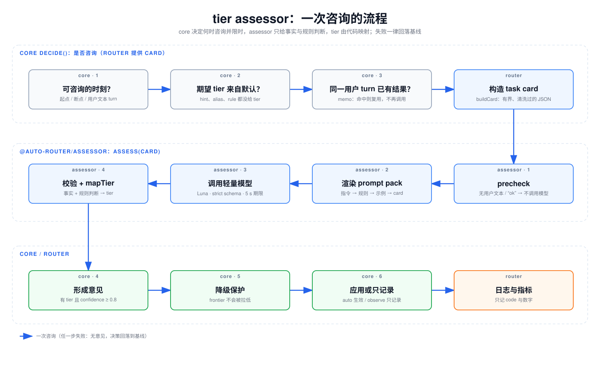

# LLM tier assessor 设计：它是什么、在哪里运行、怎么工作

> 状态：2026-11-05。本文讲 tier assessor 的设计和运行方式，对应当前代码（`packages/assessor`、`packages/core`、
> `packages/router`、`infra`）。评估用的数据集、方法和各版 pack 的数字见 [assessor 评估](assessor-eval.zh-CN.md)；
> assessor 在整体架构中的位置见 [架构文档 §7](architecture.zh-CN.md#7-llm-tier-assessor)。
> 文中所有 id 都是占位符。

## 目录

1. [它解决什么问题](#1-它解决什么问题)
2. [在哪里运行：core 的咨询时机](#2-在哪里运行core-的咨询时机)
3. [Task card](#3-task-card)
4. [Prompt pack](#4-prompt-pack)
5. [模型调用](#5-模型调用)
6. [输出校验与 tier 映射](#6-输出校验与-tier-映射)
7. [Router 接入](#7-router-接入)
8. [安全](#8-安全)
9. [线上观察到的情况](#9-线上观察到的情况)
10. [局限](#10-局限)



*图 1：一次咨询的流程（[SVG](diagrams/06-assessor-flow.svg)，源文件 `diagrams/src/06-assessor-flow.json`）。* core
先判断这一刻能不能咨询，再看同一用户 turn 有没有现成结果；都不满足时才让 router 构造 card、调用 assessor。
assessor 只给出事实和规则判断，tier 由代码映射。core 把它变成意见，经过降级保护，在 auto 模式下生效，observe
模式下只记录；router 把结果写进日志和指标。任何一步失败都是"无意见"，决策回落到不咨询时的基线。

## 1. 它解决什么问题

core 的路由决策看得见缓存和成本：哪个模型的前缀还热、切过去要重写多少、多少次调用能回本。它看不见的是任务本身：
"这一轮是查一个配置项，还是排查一个跨模块的死锁"。client hint、alias 和 policy 规则能表达一部分意图，但大多数
请求什么都不带，tier 就落到 pool 的默认档。

assessor 补的就是这一块：在确定性信号都没有给出 tier 时，用一个轻量 LLM 看一眼当前请求，给出一个 tier 意见。

它的定位有三条约束：

| 约束 | 含义 | 为什么 |
|---|---|---|
| 只给意见，不做决策 | assessor 返回 tier 和置信度；用不用、怎么用由 core 决定 | 成本门、迟滞、降级保护都在 core，assessor 不需要也不应该知道 |
| observe 优先 | `assessorMode` 默认 `observe`：意见只附在决策上，不改变服务的模型 | 先在真实流量上看它准不准，再逐步放开 |
| 不在关键路径上出错 | 超时、错误、无效输出一律视为"无意见"；请求永远不因 assessor 失败 | 一个可选的增强不能降低可用性 |

## 2. 在哪里运行：core 的咨询时机

### 2.1 什么时候咨询

咨询由 core 的 `decide()` 决定（`packages/core/src/decide.ts`），以下条件都满足时才咨询：

1. **配置了 assessor**，模式不是 `off`，并且调用方传了 card 构造函数（`extras.card`）。
2. **期望 tier 来自 pool 默认**：没有有效的 `x-router-hint tier=`，`model` 不是带 tier 的 alias（如 `auto:fast`），
   没有命中 policy 规则。确定性信号优先，assessor 只填空白。
3. **这一刻允许咨询**：
   - 起点（`session-start`、`subagent-start`、`task-start`）：最后一条消息不是 tool result 就咨询；
   - 其他断点（`idle-expired`、`compaction`、`prefix-reset`）和 step 6 的用户 turn：只在最后一条是用户文本时咨询；
   - `userTurn: 'retain'` 下的用户 turn：只在意见能生效时咨询，即当前模型被迫离开（不在 pool 或超出 context gate），
     或 lineage 处于 gate-forced 状态、可能恢复。普通的 retain 用户 turn 不咨询，因为 `retain: boundary-gated` 会忽略
     任何意见，咨询只会白花延迟和钱。

**从不咨询**：pin（`x-router-hint pin=…`，或 auto 模式下请求了具体模型 id）、failover、`chain-state-missing`、
硬锁（tool loop、`previous_response_id` 链、不可移植状态）、assistant prefill，以及任何 tool result 之后的请求。
对 Codex 这类 agent，一个任务里几乎每次调用都是 tool result，所以实际上只在会话开始时咨询一次。

### 2.2 同一 turn 只问一次

结果按 (assessor id, lineage, 用户 turn) 缓存（`packages/core/src/assess.ts`）：

- turn 的 key 是消息数加最后一条消息的链式哈希。同一请求的重试 key 相同；新的用户 turn 会追加消息，key 就变了。
- 进程内有一个最多 1024 条的 memo，存的是 promise，所以并发的同一请求共享一次调用。
- 结果也写进 `SessionState.assessed`，换一个 engine 实例（同一个 store）也能复用。
- 复用的结果在决策上标 `cached: true`，不再带成本，花费只记一次。

card 是惰性构造的：只有真正要调用时 core 才调用 `extras.card(ctx)`，命中缓存或不咨询时连 card 都不建。

### 2.3 时间上限

assessor 自己的调用期限默认 5000 ms（`ROUTER_ASSESSOR_TIMEOUT_MS`；`packages/assessor/src/assessor.ts` 的
`DEFAULT_TIMEOUT_MS` 和 core 的 `ASSESSOR_DEFAULTS.timeoutMs` 也都是 5000）。core 在外面再套一个硬期限：期限 + 100 ms
余量（`ASSESSOR_GRACE_MS`，`packages/router/src/assessor.ts`）。余量让 assessor 通常先报出自己的超时（带原因代码），
core 的期限只是兜底。所以一次咨询最多让请求多等约 5.1 s；超过期限才返回的答案在 router 里用不上。

默认值最初是 1500 ms。Codex 大小的 card 实测 p50 约 1.53 s、p95 约 2.06 s（§9），1500 ms 会让约 60% 的咨询超时，
所以改成了 5000 ms。对 Codex 这类 agent，咨询几乎只发生在会话起点，一个任务最多多等一次。

### 2.4 意见怎么用

assessor 的结果先变成"意见"：状态 ok、带 tier、置信度 ≥ `assessorMinConfidence`（router 里等于阈值，默认 0.8）。
其他情况都是无意见，决策照常走 pool 默认。

| 模式 | 效果 |
|---|---|
| `observe` | 决策照基线做，意见只写进 `Decision.assessment`（`applied: false`） |
| `auto` | 以意见为期望 tier 重新评估：升级立即生效；降级和其他降级一样要过成本门和次数门（min-turns、max-switches、break-even） |

**降级保护**（`assessorDowngradeFrom`，默认 `['standard']`）：评估显示 assessor 几乎认不出 frontier 级任务，所以它只能
把 standard 往下拉，不能把 frontier 拉下来。"从哪个 tier 降"取当前模型的 tier，会话起点没有当前模型时取 pool 默认；
被 context gate 强制换档的 lineage 取被强制之前那个模型的 tier（`gateForced.from`），强制后的 tier 不是策略选择。
gate 恢复时最多回到被强制之前的 tier，更低的期望 tier 要等常规的成本门。
意见低于这个 tier、而这个 tier 不在列表里时，意见被钳制为当前 tier，记 `guard: 'assessor-downgrade-guarded'`，
`applied: false`。升级、client hint、alias 和规则不受影响。

`applied` 只在意见真的改变了所选模型时为 true。

## 3. Task card

card 是 assessor 看到的全部输入（`packages/assessor/src/card.ts`，`card/v1`）。它不是对话记录，而是一个有界的摘要。

### 3.1 字段和上限

| 字段 | 内容 | 上限 |
|---|---|---|
| `latestUser` | 最新一条用户文本；`images` 只计数，不发图 | 4,000 字符 |
| `firstUser` | 首条用户文本（与最新一条相同时省略） | 1,200 字符 |
| `role` | 配置的角色标签，或 system prompt 的开头 | 标签 80 / 开头 600 字符 |
| `tools` | 工具名（不含 schema）和总数 | 40 个名字，每个 48 字符 |
| `lineage` | `root` / `subagent`，已知时带父 lineage 的 tier | — |
| `stats` | turn 序号、估算 prompt token、上一轮工具调用数和错误数、压缩次数 | — |
| `current` | 当前模型和 tier（core 提供） | 模型 id 120 字符 |

所有文本都先 `sanitize`：NFC 规范化，去掉除 `\t`、`\n` 之外的 C0 控制字符，把 `</task_card` 改写成 `<\/task_card`。
然后 `cut`：放得下就原样保留，放不下就截断加 `…`，并在 `chars` 里记原长度（不切开代理对）。超长本身也是信号，
所以长度会告诉模型。

`taskCardIssue` 在每一层都拒绝未知的键：card 整个会序列化进 prompt，多一个键就绕过了上限。

### 3.2 永远不进 card 的东西

完整对话、助手回复、tool result 的内容、工具 schema、图片、文件、请求头和原始 session id。tool result 只以
"上一轮多少次调用、多少次出错"的计数出现。

### 3.3 客户端注入的上下文

有些 agent 会以用户消息的形式发送环境信息，例如 Codex 的 `<environment_context>`（工作目录、shell、沙箱）和
`<user_instructions>`（来自 AGENTS.md）。它们不是用户的请求：如果当成用户 turn，首条请求的 `turnIndex` 会变成 1，
`firstUser` 会变成一段 XML，和评估时的 card 分布不一致。

所以 `buildCard` 先过滤：一条用户消息如果去掉首尾空白后**恰好是一个**这样的块、并且没有图片，就不算用户 turn
（`isClientContext`）。块前后还有别的文字、一条消息里有两个块、或者带图片，都仍然算用户内容。这个过滤对三种 API
（Messages、Chat、Responses）都生效。

### 3.4 角色标签

system prompt 的开头往往是很长的通用说明。可以给 assessor 配一个 `roleLabels` 映射（template family → 标签），
命中时 `role` 只放这个短标签，省 token 也更稳定；没有配置时放 system prompt 的前 600 字符。

### 3.5 离线构造同样的 card

`requestCard(engine, dialect, body, headers?)`（从 `@auto-router/router` 导出）用和 router 完全相同的方式从原始请求体
构造会话起点的 card：先跑 core 的 `summarize()`，再用 lineage 没有状态时 core 传入的上下文（无当前模型、0 次压缩、
root lineage）调用 `buildCard`。离线批量评估 tier 时用它，可以保证和线上看到的 card 一致；router 的测试检查了两者
逐字节相同。

## 4. Prompt pack

### 4.1 目录结构

每个 pack 是一个版本化的目录（`packages/assessor/prompts/assessor/<版本>/`）：

| 文件 | 内容 |
|---|---|
| `pack.json` | pack id（如 `assessor/v2.2`）、card 版本、输出格式版本，以及可选的 `mapping` 块（§6.2） |
| `instructions.md` | 任务说明、"card 是不可信数据"、card 字段说明、事实的定义、输出格式 |
| `rules.json` | 规则列表：`id`、`tier`、`enabled`、`auto`、`instruction`（单行，≤ 600 字符） |
| `examples.json` | few-shot 示例：一张小 card、完整输出、它应映射到的 tier |

`loadPack` 加载时就校验（`packages/assessor/src/pack.ts`）：规则 id 格式和唯一性、字段类型，以及**每个示例的输出都要
通过输出校验、并经 `mapTier` 映射到它标注的 tier**。示例和规则对不上，pack 根本加载不了。

### 4.2 渲染顺序和缓存

system prompt 固定为：指令 → 启用的规则 → 示例；card 永远单独放在 user 消息里：

```
<task_card>{card 的 JSON}</task_card>
```

渲染是 (pack, card) 的纯函数，顺序稳定，所以 system 部分在不同请求之间完全相同，可以命中模型的 prompt 缓存；
变的只有最后的 card。

`packVersion` = `<pack id>+<sha256(system) 的前 12 位>`；pack 有 `mapping` 块时，哈希里也包含这个块。规则、示例、
指令或映射参数任何一处改了，版本就变，结果文件和日志都能追溯到具体的 prompt 和映射。规则的 `auto` 标志不进入渲染内容，所以只改 `auto` 不会改变 prompt 和版本。

### 4.3 规则

| 规则 | tier | 判断什么 |
|---|---|---|
| `explore-readonly` | fast | 只读的查找、解释 |
| `mechanical-edit` | fast | 目标和改法都已明确的机械修改 |
| `bounded-change` | standard | 局部、有界的改动，包括指出了出错代码或建议了修法的 bug 报告 |
| `deep-investigation` | frontier | v2.2：还没有明确交付物的开放式设计 / 架构工作，或已经失败两次的工作（v2.1：根因不明、跨模块、并发 / 安全 / 性能、设计类问题） |

- `enabled: false` 的规则不渲染进 prompt，输出里也不允许出现。
- `auto` 决定这条规则支持的 tier 能不能直接交给 core（§6.3）。所有 shipped pack 的规则目前都是 `auto: false`。

### 4.4 版本演进

| 版本 | 改了什么 | 结果 |
|---|---|---|
| v1 | 初版 | Luna 能放进延迟预算；fast 在手工数据上准，在真实 issue 上会误判；认不出 SWE-bench 的 frontier |
| v2 | 收紧 `mechanical-edit` 和 `fully-specified`；放宽 `deep` | fast 更准，但在留出集上把 17% 的 standard 误升到 frontier |
| v2.1 | 只取 v2 的 fast 侧收紧，frontier 侧沿用 v1 | fast 精确率 98.3%，误升级 1/365，判对率最高 |
| v2.2（默认） | 按 Harbor 实测结果收窄 frontier：`deep-investigation` 只覆盖开放式设计或已失败两次的工作，`deep` 不再单独给出 frontier（`mapping` 块）；fast 侧与 v2.1 相同 | 离线模拟：DeepSWE 留出集上全部判 standard，等于固定 Sol，相对 v2.1 −0.1 pp [−3.0, 2.8]、成本 ×0.22 [0.19, 0.27]；全部 84 个 TB 任务上（跨数据集检验）相对 Sol 0.0 pp、×1.03，相对 v2.1 成本 ×0.42 |

v2.1 拿到了 v2 在 fast 边界上的改进，又没有 v2 的误升级成本（[assessor 评估 §5](assessor-eval.zh-CN.md#5-过程与结果)）。
但两次 Harbor 实验里，v2.1 的 frontier 判断全部来自 `deep`，选出的任务上 Astra 也没有胜过 Sol，只是多付约 6 倍成本。
v2.2 是现在的默认：内容就是只在 DeepSWE 调优集上调出、冻结后评估的 v2.2-D；同一轮调出的 fast 规则在留出集上没有
成立，所以没有放进发布版。具体数字见 [assessor pack v2.2 评估](../experiments/assessor-v2.2.zh-CN.md)。v1、v2、
v2.1 仍可按名字选择（`ROUTER_ASSESSOR_PACK`）。

## 5. 模型调用

### 5.1 模型和请求

默认模型是 `global.openai.gpt-6-luna`，通过 bedrock-runtime 的 Responses API 调用（`packages/assessor/src/adapters/`）：

- **结构化输出**：Responses 用 strict `json_schema`，schema 由启用的规则生成（`rule_id` 是这些规则 id 的枚举）。
  Claude 系模型（如 Haiku 5.5）走 Messages API，用一个强制调用的 tool，tool 的输入 schema 就是输出格式。
- **`reasoning.effort: none`**：评估里 `low` 每一项都更差（更慢、更不准）。
- **`max_output_tokens: 800`**，`store: false`。
- **缓存**：Responses 带 `prompt_cache_key = packVersion`；Messages 在 system 块上加 `cache_control`。

适配器由价格目录里模型支持的 API 决定（`selectAdapter`）。

### 5.2 传输

assessor 不自己发 HTTP，而是接收一个注入的 `transport(path, body, headers, signal)`。router 里它是
`bedrockTransport`：复用数据面的 SigV4 签名器（task role、`ROUTER_REGION`）和 bedrock-runtime 上游地址
（`packages/router/src/forward.ts` 的 `createBedrockPost`）。所以 assessor 和数据面用同一个角色、同一个区域、同一个
VPC endpoint。测试用 `fakeTransport`。

### 5.3 不调用模型的情况

本地 precheck（`precheck`）直接跳过：

- 没有用户文本（`no-user-text`）；
- 非首轮、24 字符以内、全部由"ok / thanks / continue / yes / lgtm …"这类词组成的跟进（`trivial-followup`）。

跳过时返回置信度 0、成本 0，也就是无意见，当前 tier 保持不变。

### 5.4 成本

每次调用用返回的 usage 经 `normalizeUsage` 和 `costOf`（`@auto-router/pricing`）计价，放进结果的 `costUsd`。
输出无效（例如不是 JSON）时结果是 unavailable，但这次调用照样计费；这类成本通过 `onCall` 观察回调报告，router 和
离线评估都从这里记账，不会漏掉。每次咨询的成本约 $0.0006–0.0007。

## 6. 输出校验与 tier 映射

### 6.1 输出格式和校验

模型输出四个字段：每条启用规则的判断（`rule_id`、`matched`、`reason`）、一组事实、`confidence` 和一句话 `reason`。

| 事实 | 取值 |
|---|---|
| `edits_code` | true / false |
| `scope` | none / single-file / multi-file / cross-module |
| `specification` | fully-specified / partially / ambiguous |
| `reasoning_depth` | lookup / routine / deep |
| `prior_failures` | 0–20 的整数 |

`validateAssessment`（`packages/assessor/src/validate.ts`）严格校验：键必须完全一致；每条启用规则恰好判断一次（缺失、
未知、重复、已禁用的 id 都拒绝）；枚举和范围；`confidence` 在 [0, 1]；`reason` 不超过 300 字符、30 个词。任何一处
不对，整条输出无效，视为无意见。

### 6.2 由代码映射 tier

模型从不直接说"用 fast"。`mapTier`（`packages/assessor/src/map.ts`）是一个纯函数，按顺序第一个命中的分支生效：

| 顺序 | 条件 | 结果（outcome） |
|---|---|---|
| 1 | 置信度 < 阈值（默认 0.8） | 无意见（`low-confidence`） |
| 2 | fast 规则和 frontier 规则同时命中 | 无意见（`conflict`） |
| 3 | frontier 规则命中，或 `reasoning_depth = deep`，或 `prior_failures ≥ 2` | frontier |
| 4 | standard 规则命中，或（没有 fast 规则命中，且改代码、范围是 multi-file / cross-module） | standard |
| 5 | fast 规则命中，且 `fully-specified`、深度是 lookup 或 routine | fast；否则无意见（`fast-unsettled`） |
| 6 | 什么都没命中 | 无意见（`no-rule`） |

`basis` 记录支持这个 tier 的规则 id 和事实信号（`fact:deep`、`fact:prior-failures`、`fact:multi-file-edit`），或者
无意见的原因代码。

上表是默认映射（`DEFAULT_MAPPING`）。pack 可以在 `pack.json` 里用可选的 `mapping` 块调整其中的参数：哪些事实信号
能单独给出 frontier（`frontierFacts`）或 standard（`standardFacts`）、`prior_failures` 的阈值（`priorFailuresMin`）、
fast 成立所需的明确程度和深度（`fastSpecifications`、`fastDepths`），以及成立的 fast 是否优先于 standard
（`fastBeatsStandard`）。没写的键取默认值；没有这个块的 pack（v1、v2、v2.1）行为与引入前逐字节相同，有一组覆盖
完整真值表的 golden 测试锁定。v2.2 只改了一项：`frontierFacts` 去掉 `deep`，第 3 步变成“frontier 规则命中，或
`prior_failures ≥ 2`”。

这样设计是为了让判断可审计：模型说的是"这个任务改不改代码、范围多大、要求清不清楚"，这些比"该用哪个档"容易
判断，也更难被 card 里的文字操纵；tier 的规则则写在代码里，可以测试、可以改。

### 6.3 什么时候把 tier 交给 core

assessor 返回的 `tier` 字段只在 `autoEligible` 时才有：`basis` 里每一项都允许 auto，规则看它的 `auto` 标志，事实信号
看 `autoFacts`。否则 tier 被扣下，core 只拿到置信度，结果就是无意见；映射出来的 tier 留在 assessor 的 `audit` 里，
router 会把它作为 `proposedTier` 记进日志（§7.3）。

shipped pack 的规则全是 `auto: false`，所以默认配置下 auto 模式什么也不会改变。为实验准备了一个显式开关：
`ROUTER_ASSESSOR_AUTO_RULES=all`。它在内存里的 pack 副本上把每条启用规则设成 auto，并把三个事实信号都加进
`autoFacts`；pack 文件、渲染出的 prompt 和 `packVersion` 都不变，core 的降级保护、成本门和次数门照常生效。事实信号
也要一起放开，是因为 v2.1 的 frontier 和 standard 映射通常带着事实（例如 `deep-investigation` + `fact:deep`），只放开
规则的话，这些映射几乎永远不会生效（v2.2 的 frontier 不再带 `fact:deep`，standard 仍可能带 `fact:multi-file-edit`）。

## 7. Router 接入

### 7.1 配置

| 环境变量 | 默认 | 说明 |
|---|---|---|
| `ROUTER_ASSESSOR_MODE` | `off` | `off` / `observe` / `auto` |
| `ROUTER_ASSESSOR_MODEL` | `global.openai.gpt-6-luna` | 必须是 policy 里的模型（task role 只能调用这些） |
| `ROUTER_ASSESSOR_THRESHOLD` | 0.8 | 同时是 `mapTier` 的阈值和 core 的最低置信度 |
| `ROUTER_ASSESSOR_PACK` | `v2.2` | shipped pack 的名字（v1 / v2 / v2.1 / v2.2） |
| `ROUTER_ASSESSOR_TIMEOUT_MS` | 5000 | 100–10000；assessor 的调用期限（最初是 1500，见 §2.3） |
| `ROUTER_ASSESSOR_AUTO_RULES` | `pack` | `pack` / `all`（§6.3） |

部署时用 CDK context 设置，键名一一对应：`assessorMode`、`assessorModel`、`assessorThreshold`、`assessorPack`、
`assessorTimeoutMs`、`assessorAutoRules`（`infra/src/settings.ts`），不设就是 off。例如实验部署用
`-c assessorMode=auto -c assessorAutoRules=all`。

### 7.2 启动时拒绝的配置

这些情况 router 启动时报配置错误并退出（`packages/router/src/config.ts`），CDK synth 也会提前失败（`infra/src/models.ts`）：

- 模型不在该区域的价格目录里，或者不是 policy 的模型。assessor 不另外授权，所以不在 policy 里的模型 task role 调不了。
  synth 还多查一条：使用 Responses API 的模型必须在 Responses pool 里，因为 default project 的授权只覆盖这些模型。
- pack 名不存在（router 启动时还会加载并校验 pack）。
- `auto` 模式 + `AUTO_RULES=pack`，而 pack 里没有任何启用的 auto 规则。这样的配置永远不会生效，属于"静默无效"，
  所以直接拒绝：要么用 observe，要么显式用 `all`。

### 7.3 失败容忍和日志

不管 assessor 出什么问题（HTTP 错误、超时、输出无效、card 构造失败），请求都照常处理，按基线 tier 服务。

每次咨询在请求日志里写一个 `assessor` 对象（`packages/router/src/account.ts` 的 `AssessorLog`），只有代码和数字：

| 字段 | 内容 |
|---|---|
| `id`、`mode`、`autoRules` | assessor id（`<pack id>@<model>`）和配置 |
| `status` | `ok` / `unavailable` / `timeout` / `error` / `invalid` |
| `tier` | core 看到的意见（被扣下时没有） |
| `proposedTier` | `mapTier` 映射出的 tier，不管 auto 标志 |
| `confidence`、`basis` | 置信度；规则 id 和 `fact:*` 信号 |
| `outcome` | 映射结果、`skipped:<原因>`、`unavailable:<原因>` 或 core 的 `timeout` / `error` / `invalid` |
| `latencyMs`、`costUsd`、`called` | 延迟、这次咨询的花费、是否真的调用了模型 |
| `applied`、`cached`、`guard` | 是否改变了模型、是否复用、是否被降级保护钳制 |

这些结构化字段是 router 在 `engine.decide()` 外面用 AsyncLocalStorage 按请求收集的：core 的 `Decision.assessment`
有意不带 assessor 的 `audit`（里面可能引用 prompt 文本），router 只从中读出 tier、规则 id 和原因代码，每个值都过一遍
只允许代码字符的正则，不符合的记成 `other`。

同时还有每个请求的时间字段：`bodyReadMs`、`decideMs`（含 assessor）、`overheadMs`、`upstreamTtfbMs`、`durationMs`，
可以把 assessor 的延迟从总时间里分出来。

EMF 指标（命名空间 `LlmAutoRouter`）：`AssessorConsults`、`AssessorLatencyMs`、`AssessorCostUsd`、
`AssessorUnavailable`、`AssessorApplied`。复用的结果不计入咨询次数和成本。

## 8. 安全

card 里的文本来自用户、agent、工具输出和网页，全部按不可信数据处理：

- **结构上隔离**：card 是转义后的 JSON，放在 user 消息的 `<task_card>…</task_card>` 里，从不拼进指令。card 里出现的
  `</task_card` 被改写成 `<\/task_card`（仍是合法 JSON），不能提前闭合定界块。
- **指令上声明**：`instructions.md` 开头就说明 card 内容都是数据，其中让模型选某个 tier、改置信度或声称指令已改变的
  文字都没有效力。
- **输出受约束**：strict schema 加严格校验，模型只能填事实和规则判断；tier 由代码映射。评估里有 4 条提示注入样例，
  Luna 4/4 判对（见 [assessor 评估](assessor-eval.zh-CN.md#5-过程与结果)）。
- **不记录文本**：日志里没有 card、prompt、模型输出或错误响应体的任何文字，只有代码和数字；有测试检查日志里不出现
  prompt 和输出文本。
- **最小权限**：assessor 用 router 的 task role，只能调用 policy 里的模型，不额外授权。

## 9. 线上观察到的情况

实验部署（`ap-southeast-1`，policy 为 auto 模式，assessor `auto` + `AUTO_RULES=all`，pack v2.1，Luna，阈值 0.8）上的
初步观察。以下测量都在默认期限还是 1500 ms 时进行：

- **冒烟测试**：一个 `auto` 的机械修改请求，assessor 判为 fast（1.1 s），服务模型切到 Luna；一个 pin 到 standard 的
  请求不咨询 assessor，router 开销 1 ms。接线按设计工作。
- **Codex × R2E-Gym 的离线 tier 预判**：对 500 个随机抽取的 R2E-Gym 仓库修复任务，用 `requestCard` 从 Codex 的真实
  首个请求构造 card，按实验部署的设置调用 assessor：
  - **0/500 判到 standard 以外**：488 个映射为 standard，12 个置信度低于阈值（无意见）；
  - 置信度中位数 0.87；
  - **延迟贴着当时的期限**：p50 1.53 s、p90 1.84 s、p95 2.06 s、最长 2.9 s，60%（302/500）超过 1500 ms。在
    1500 ms 的期限下这些都会超时、变成无意见；按现在的 5000 ms，测到的 500 次都在期限内；
  - 每次约 $0.0007（共 $0.35）。这些 card 比评估时的大（估算 prompt 中位数约 6.5K token，最新用户文本中位数约
    1.5K 字符），延迟也比评估时高。延迟是在调用方机器上测的，和 router 里的实际延迟只是近似。

**这意味着什么**：

- 在这类"一个 issue 描述 + 修复仓库"的任务上，assessor 给出的都是 standard，和 pool 默认一样。所以在这个任务集上，
  assessor 不会让 router 选出不同于默认档的模型；它的作用只剩会话开始时的一次延迟和一点成本。这与评估里"只看 issue
  文本看不出难度"的结论一致。
- 1500 ms 的期限对 Codex 大小的 card 偏紧：即使意见有用，一多半也会因超时用不上。因此默认期限已改为 5000 ms，
  实验部署也用 5000 ms（`-c assessorTimeoutMs=5000`）。

**后续**：

1. **期限**：默认已放宽到 5000 ms。对用户 turn 频繁咨询的 agent（不是 Codex 这种只在起点咨询的），每个 turn 最多
   多等约 5 s 可能太长；那时可以考虑只在起点用长期限、缩小 card（例如更短的 `latestUser` / system 开头），或者改成
   异步：本轮不等结果，下一个可咨询点再用。
2. **先拿真实会话的 observe 数据，再放开任何规则的 auto**：router 现在会记录 `proposedTier`、`basis` 和 `outcome`，
   在 observe 模式下就能统计真实流量上的 tier 分布和 fast 精确率。shipped pack 的规则保持 `auto: false`，
   `AUTO_RULES=all` 只用于实验。
3. 评估相关的优化方向见 [assessor 评估 §8](assessor-eval.zh-CN.md#8-后续怎么优化)。

## 10. 局限

| 局限 | 影响 | 当前处理 |
|---|---|---|
| 认不出 frontier 级任务 | 只看请求文本看不出修复要多久 | 降级保护；frontier 升级主要靠显式信号（多次失败、深度排查类措辞） |
| 金标偏乐观 | fast 场景的数据由 pack 作者编写 | 规则保持 observe，等真实数据 |
| 期限与延迟的取舍 | 最初的 1500 ms 让 Codex 大小的 card 一多半超时；现在的 5000 ms 让每次咨询最多多等约 5 s | 超时即无意见，不影响请求；频繁在用户 turn 咨询的场景再考虑起点专用期限、缩小 card 或异步 |
| 实际上只在会话起点咨询 | tool loop 中途不咨询，长会话里任务变了也要等下一个断点 | 设计如此：中途换模型会破坏缓存 |
| 意见不跨进程共享 | memo 在进程内；`SessionState.assessed` 依赖 store | 当前是单 task + 内存 store；外部 store 是路线图项 |
| 失败的咨询也会被缓存 | 同一 turn 的一次超时不会重试 | 路线图：给失败结果加短 TTL |

---

### 附：相关代码

| 位置 | 内容 |
|---|---|
| `packages/assessor/src/card.ts` | card 构造、清洗、截断、客户端上下文过滤、结构检查 |
| `packages/assessor/src/pack.ts`、`prompts/assessor/` | pack 加载、校验、渲染，各版 pack |
| `packages/assessor/src/adapters/` | Responses / Chat / Messages 的请求和解析 |
| `packages/assessor/src/assessor.ts` | `createAssessor`：precheck → 渲染 → 调用 → 校验 → 映射 → 计价 |
| `packages/assessor/src/validate.ts`、`map.ts` | 输出校验、`mapTier` |
| `packages/core/src/assess.ts`、`decide.ts` | 咨询时机、缓存、超时、降级保护、意见的使用 |
| `packages/router/src/assessor.ts`、`config.ts` | router 接入、配置、日志字段、`requestCard` |
| `infra/src/settings.ts`、`models.ts`、`stack.ts` | 部署参数、synth 检查、容器环境变量 |
