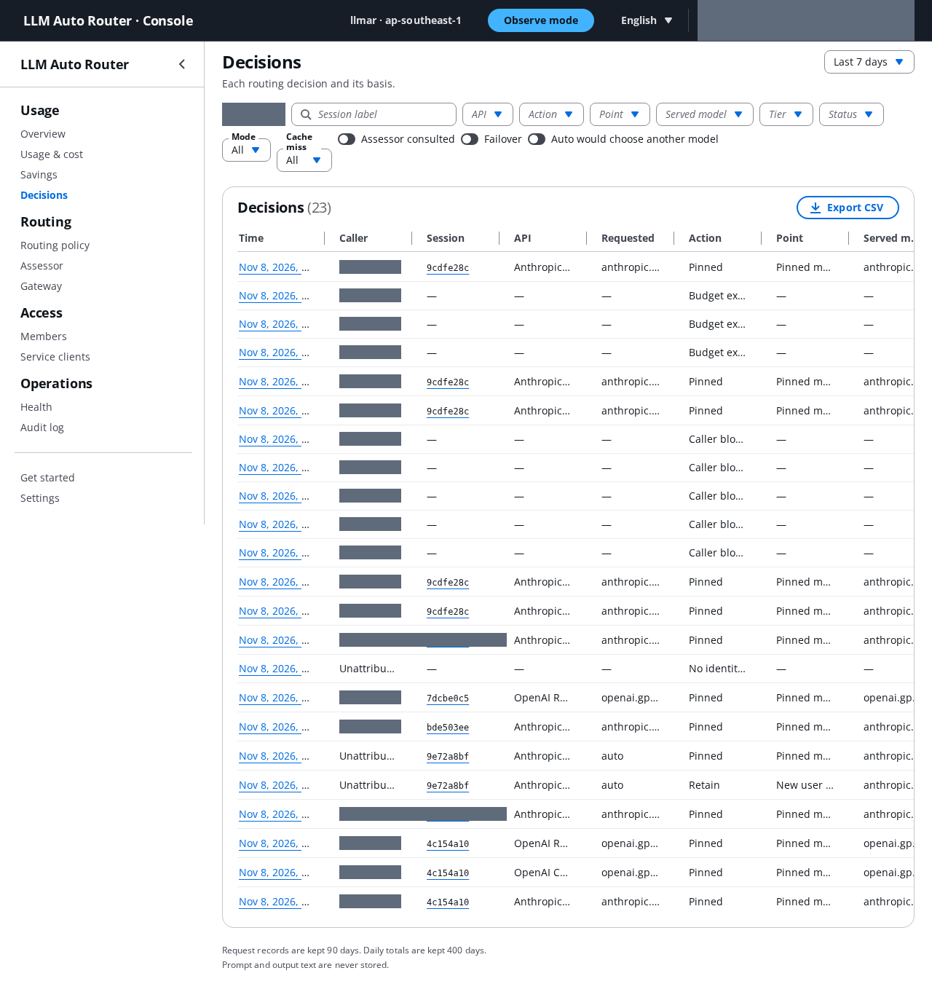

# Admin console guide

[简体中文](README.zh-CN.md)

The admin console is a web app for one router deployment. Members use it to connect their tools and to see their
own usage. Admins also manage members, service clients, the routing policy and the assessor. It is an optional
stack: deploy it after the router stack ([infra/README.md](../../infra/README.md#admin-console-console-stack)).

The console works in English and Simplified Chinese. Switch with the language menu at the top; the choice is kept in
this browser.

## Signing in

- There is no self sign-up. An admin invites you, and Cognito sends an e-mail with a temporary password.
- The first admin is created when the console stack is deployed, with `-c adminEmail=<e-mail>`
  ([infra/README.md](../../infra/README.md#console-inputs)). If no admin is left, deploy again with it.
- At first sign-in you replace the temporary password with your own.
- MFA is off by default. For production, whoever deploys the stack should require it (see [Production hardening](#production-hardening)).
- The console signs you out after 8 hours. "Sign out everywhere" (Settings) signs you out of every browser and
  revokes the `llmar` CLI's sign-in. The CLI notices at its next refresh, within the 60-minute token lifetime, and
  the gateway accepts tokens already issued until they expire.

## What everyone sees

Members see only their own requests. Admins see everyone's, and can filter by caller.

*The Decisions page after the end-to-end test, admin view. Callers are masked; sessions show their short label.*

| Page | What it shows |
|---|---|
| Overview | This month's list-price cost, requests, tokens and cache hit rate; your budget, if you have one; recent sessions. |
| Usage & cost | Token usage per model by class (uncached input, cache read, cache write per TTL, output) and its list price, per UTC day. Group by model, tier or API; export CSV. |
| Savings | What routing changed in list-price cost against a baseline (see below). |
| Decisions | Each routing decision: requested model, action, decision point, served model, tokens, cost, cache hit rate, assessor opinion and its basis. Open a session to see its timeline. |
| Get started | Setup for `llmar`, Claude Code, Codex, the SDKs and curl, filled in with this deployment's values, and a "Check my setup" button. |
| Settings | Language, time display (local or UTC), password, sign out everywhere. |

### Reading the numbers

- **List price, not your invoice.** Costs use the Region's versioned price catalog (its version is in the page
  footer). Discounts, credits and taxes are not included.
- **What is counted.** Every request that reached the router. Calls the gateway fallback served while the router was
  failing are not seen by the router, so they are missing.
- **Unmetered calls.** If a stream ended before usage arrived, the call has no measured cost. The console shows the
  count and an approximate upper bound apart from the metered cost, and leaves these calls out of savings. The
  bound uses a prompt estimate of 4 characters per token, so it can be too low for Chinese, Japanese or Korean
  text. "Partial (input only)" means some calls set no output cap.
- **Days are UTC.** Request records are kept 90 days by default (deploy setting `recordRetentionDays`; a change
  applies to new records). Daily totals are kept 400 days.
- **No content.** Prompt and output text are never stored. Records hold ids, codes, token counts and costs.

### Savings

The page compares actual cost `A` with a baseline `B`: the same requests priced on one fixed model that never
switches. The default baseline is the tier each request asked for (`auto` → the pool's default tier). You can also
pick always `standard`, always `frontier`, or the observe default.

- Net saving `N = B − A − X` = routing effect `R` − switch penalty `S` − assessor overhead `X`. It can be negative.
- `R = B − A*` is the price difference with cold-cache effects removed (`A*` is the warm-equivalent cost). `S = A −
  A*` is the extra cache writing when routing moved a warm session to another model.
- Requests served at a lower tier because of a tier limit are shown on their own row; a forced downgrade is not a
  routing saving.
- In observe mode, "Projected if auto" estimates what auto mode would have cost. It is indicative, not measured.
- Prompt-cache saving is a separate figure. It comes from caching, not from routing.

Three limits apply to every savings figure. It uses list prices. It assumes the same token usage on the baseline
model, while a different model may use more or fewer tokens and turns. It does not measure quality: a cheaper model
may solve fewer tasks. On our coding-agent benchmarks the fast tier solved 14–17 points fewer tasks than standard,
and auto with the assessor cost 2.6–4.1 times fixed standard with no quality gain detected
([summary, Chinese](../experiments/harbor-summary.zh-CN.md)).

## Admin pages

### Members

- **Invite** with e-mail, name, role (member or admin), and an optional monthly budget and tier limit. Invites use
  Cognito's default e-mail sender, which has a low daily quota. For larger teams, ask whoever deploys the stack to
  configure Amazon SES on the user pool.
- **Promote to admin:** the person must sign in again before the admin rights apply.
- **Disable:** the router stops serving the member within about 35 seconds in `require` mode. In `observe` mode,
  only requests that carry the member's identity are blocked; requests without it keep working until the access
  token expires (at most 60 minutes). Disabling also revokes the member's sign-in, so after Enable they run
  `llmar login` again.
- **Sign out everywhere** revokes refresh tokens. Access tokens already issued still pass the gateway until they
  expire, unless you also disable the member.
- **Delete** is possible only for disabled members. Their records stay, shown as "Deleted member".
- Changes reach the router through a published caller list and block list. The row shows "Applying…" until the
  router reports the new version, and "Not delivered" with a Republish button if publishing failed.

### Service clients

Machine callers for CI and agents, on the client-credentials flow. The secret is shown once when you create or
rotate it; store it in Secrets Manager. Budgets and tier limits work as for members. See the README section
[Service clients](../../README.md#service-clients-ci-and-agents).

### Budgets and tier limits

- A **budget** is a monthly list-price amount per caller, with an alert threshold and an optional hard stop. Spend
  is actual cost plus assessor cost for the current UTC month. With the hard stop on, the router answers 429
  `budget-exceeded` within a few minutes after the budget is used up (usage is counted from the router logs, which
  arrive in batches). Requests in that window still go through, so spend can pass the budget a little. A raised
  budget or a new month lifts the block within minutes of the caller's next request.
- A **tier limit** caps the highest tier a group (admin, member) or one caller may use, with an optional list of
  allowed pins. A request above the limit is served at the highest allowed tier; a pin above it gets 400
  `access-cap`; a context too long for every allowed model gets 400 `access-cap-context`.
- **Which calls they bind.** In `observe` mode, budgets and tier limits apply to every call that carries a valid
  `x-api-key`; a call without one is served unattributed and escapes them. They bind everyone only in `require`.

### Routing policy

The model mapping: mode (observe or auto), per-API model pools and tiers, observe defaults, aliases, rules, tier
limits and the advanced settings. Edit it in the form or as JSON.

- **Validate** runs the router's own checks against the price catalog and the allowed model list.
- **Activate** needs a comment. It shows the diff and the effect on running sessions; sessions keep their model until
  their next cache break point. The router picks the new version up within about a minute, and the header shows
  when it is active (or why the router rejected it; it then keeps the previous version).
- **Versions** lists every change with author, time and comment. Roll back creates a new version with the old
  content.
- Adding a model outside the allowed model list needs a CDK deploy.

### Assessor

Mode (off, observe, auto), pack, model, threshold, timeout and which rules may act in auto. The page lists each
pack's rules, so a decision's basis can be read. Saving creates a new config version. Keep observe mode until the
offline evaluation passes: on our benchmarks the assessor did not pick the tasks that need frontier, and never
chose fast.

### Gateway

A read-only view of the gateway: URL, authorizer, targets, routing rules, fallback chain and forwarded headers. All
of it changes only with a CDK deploy.

### Health

Router tasks, request rate, 4xx and 5xx rates, failovers, router overhead, upstream first byte, cache hit rate,
assessor latency, active config version and record delay. The gateway publishes no fallback count, so "Signs of
gateway fallback" shows proxies: router 5xx, unhealthy router targets, and fewer running tasks than desired.

### Audit log

Every admin action (members, service clients, config, settings) and every config rejection by the router, with
actor, time, before and after. It cannot be edited.

### Settings: deployment

- **Identity mode.** Roll out in this order: `observe` while members set up their tools, check that the
  "unattributed" share on the Overview is near zero, then `require`. The console refuses `require` until the router
  reports that its signing keys are loaded, because without them every call would get 401.
- Default budget and alert threshold, hard stop, default savings baseline.
- Read-only: record retention, price catalog and Region, allowed models, `llmar` sign-in lifetime (30 days). These change with a
  CDK deploy.

## Production hardening

The user pool ships with MFA off. For production, require TOTP MFA (an authenticator app) on the user pool. It is a
stack setting, not a console setting: see [infra/README.md](../../infra/README.md#production-hardening-mfa). After
the change, everyone sets up an authenticator app at their next sign-in, in the console and in `llmar login`.

## Removing the console

Destroying the console stack deletes its data: config versions, the audit log, member profiles (budgets, tier
limits), request records and daily totals. If you need any of it, export the tables first, for example with a
DynamoDB export to S3 or a scan ([infra/README.md](../../infra/README.md#console-teardown)). The router keeps
running on its last config.

## Troubleshooting

| Symptom | Cause |
|---|---|
| 401 | No token or an expired one. In `require` mode also a missing (`identity-missing`) or invalid `x-api-key`. |
| 403 `identity-blocked` | The account is disabled or blocked. A 403 without that code means the wrong scope. |
| 429 `budget-exceeded` | The monthly budget is used up and the hard stop is on. |
| 400 `access-cap` / `access-cap-context` | Above the tier limit, or no allowed model fits the context. |
| 400 `pin-not-allowed` | The pinned or named model is not in the routing policy. |
| `llmar-token` says "run llmar login" (exit 2) | The sign-in expired or was revoked, the settings changed since sign-in, or the account is disabled. |
| Codex: "auth command exited with status 2" | Run `llmar-token` in a terminal to see why. |
| "Check my setup" finds nothing | The tool does not send `x-api-key`. See Get started, step 4. |
