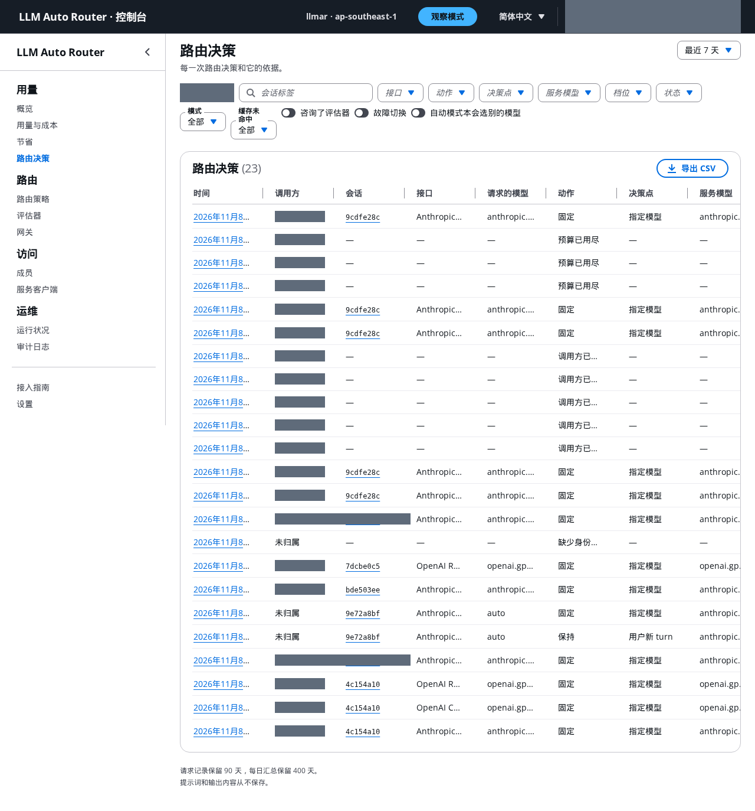

# 管理控制台使用说明

[English](README.md)

管理控制台是一个网页应用，对应一个 router 部署。成员用它接入自己的工具、查看自己的用量；管理员还用它管理成员、服务客户端、路由策略和评估器。控制台是一个可选的 stack，要在 router stack 之后部署（[infra/README.md](../../infra/README.md#admin-console-console-stack)）。

控制台支持英文和简体中文，用页面顶部的语言菜单切换；选择会保存在当前浏览器里。

## 登录

- 不开放自助注册。管理员邀请你后，Cognito 会发一封带临时密码的邮件。
- 第一个管理员在部署控制台 stack 时用 `-c adminEmail=<e-mail>` 创建（[infra/README.md](../../infra/README.md#console-inputs)）。如果一个管理员都不剩，带上这个参数重新部署即可。
- 第一次登录时，用你自己的密码替换临时密码。
- 默认不开启 MFA。生产环境请让负责部署的人开启（见[生产环境加固](#生产环境加固)）。
- 控制台登录 8 小时后自动退出。“在所有设备上退出”（设置页）会退出所有浏览器，并撤销 `llmar` 命令行的登录。命令行在下一次刷新时才会发现，也就是在 60 分钟的 token 有效期内；已签发的 token 在过期前仍能通过网关。

## 所有人都能看到的页面

成员只能看到自己的请求。管理员能看到所有人的请求，并可以按调用方筛选。

*端到端测试后的路由决策页，管理员视图。调用方已遮盖，会话只显示简短的会话标签。*

| 页面 | 内容 |
|---|---|
| 概览 | 本月的目录价成本、请求数、token 数和缓存命中率；你的预算（如果有）；最近的会话。 |
| 用量与成本 | 每个模型按类别的 token 用量（未缓存输入、缓存读取、各 TTL 的缓存写入、输出）和目录价成本，按 UTC 日期统计。可按模型、档位或接口分组，可导出 CSV。 |
| 节省 | 和基线相比，路由让目录价成本变了多少（见下文）。 |
| 路由决策 | 每一次路由决策：请求的模型、动作、决策点、服务模型、token、成本、缓存命中率、评估器的意见和依据。打开一个会话可以看它的时间线。 |
| 接入指南 | `llmar`、Claude Code、Codex、SDK 和 curl 的配置方法，已填好本部署的信息，并有“检查我的配置”按钮。 |
| 设置 | 语言、时间显示（本地时间或 UTC）、密码、在所有设备上退出。 |

### 怎样读这些数字

- **目录价，不是账单。** 成本按本区域带版本的价格目录计算（版本号在页面底部）。折扣、抵扣额度和税费都不在内。
- **统计范围。** 所有进入 router 的请求。router 出错期间由网关回退服务的调用，router 看不到，所以不在其中。
- **未计量调用。** 流在拿到用量之前就结束的调用，没有实测成本。控制台单独显示它们的数量和近似上限，不计入已计量成本，也不计入节省。上限里的提示 token 按每 4 个字符 1 个 token 估算，对中文、日文、韩文文本可能偏低。“不完整（仅输入）”表示有的调用没有设输出上限。
- **按 UTC 日期。** 请求记录默认保留 90 天（部署参数 `recordRetentionDays`，修改后只影响新记录），每日汇总保留 400 天。
- **不保存内容。** 提示词和输出内容从不保存。记录里只有 id、代码、token 数和成本。

### 节省

这一页比较实际成本 `A` 和基线 `B`：基线把同样的请求，按一个从不切换的固定模型计价。默认基线是每个请求自己请求的档位（`auto` 用模型池的默认档位）。也可以选固定 `standard`、固定 `frontier` 或观察默认模型。

- 净节省 `N = B − A − X` = 路由效果 `R` − 切换代价 `S` − 评估器开销 `X`。它可能是负数。
- `R = B − A*` 是去掉冷缓存影响后的价差（`A*` 是热缓存等价成本）。`S = A − A*` 是路由把一个热缓存的会话换到别的模型时，多出来的缓存写入。
- 因档位上限而降档服务的请求单独列一行；强制降档不算路由节省。
- 观察模式下，“自动模式预估”估算自动模式下的成本。它仅供参考，不是实测。
- 提示缓存节省是单独的数字，它来自缓存，不是路由的效果。

所有节省数字都有三条限制：用的是目录价；假设基线模型的 token 用量相同，而换一个模型，token 数和轮数都可能不同；不衡量质量，更便宜的模型可能做对的任务更少。在我们的编程 agent 基准上，fast 档的解决率比 standard 档低 14–17 个百分点；auto 加评估器的成本是固定 standard 的 2.6–4.1 倍，没有检出质量提升（[结论总结](../experiments/harbor-summary.zh-CN.md)）。

## 管理员页面

### 成员

- **邀请**：填写邮箱、姓名、角色（成员或管理员），以及可选的每月预算和档位上限。邀请邮件用 Cognito 默认的发件方式，每天的发送额度很低。团队较大时，请让负责部署的人为 user pool 配置 Amazon SES。
- **设为管理员**：对方需要重新登录，管理员权限才会生效。
- **停用**：在 `require` 模式下，约 35 秒内 router 停止为该成员服务。在 `observe` 模式下，只有带该成员身份的请求会被拦下；不带身份的请求在 access token 过期前（最多 60 分钟）仍然可用。停用还会撤销成员的登录，所以重新启用后，成员要重新运行 `llmar login`。
- **在所有设备上退出**：撤销 refresh token。已签发的 access token 在过期前仍能通过网关，除非同时停用这个成员。
- **删除**：只能删除已停用的成员。已有记录保留，显示为“已删除的成员”。
- 这些修改通过发布调用方名单和拦截名单送到 router。在 router 报告新版本之前，这一行显示“正在生效…”；如果发布失败，显示“未送达”和“重新发布”按钮。

### 服务客户端

供 CI 和 agent 使用的机器调用方，走 client credentials 流程。创建或轮换时 secret 只显示一次，请存进 Secrets Manager。预算和档位上限的规则和成员相同。见 README 的[服务客户端](../../README.zh-CN.md#服务客户端ci-和-agent)一节。

### 预算和档位上限

- **预算**：每个调用方每月的目录价额度，带提醒阈值和可选的硬性停止。支出 = 实际成本 + 评估器开销，按当前 UTC 月份计算。开启硬性停止后，预算用完几分钟内，router 返回 429 `budget-exceeded`（用量从 router 日志统计，日志是分批送达的）。这段时间内的请求照常通过，所以支出可能略微超过预算。提高预算或进入新的月份后，在该调用方下一次请求后几分钟内解除拦截。
- **档位上限**：限制一个组（管理员、成员）或某个调用方可用的最高档位，可以附带允许指定的模型列表。请求的档位超过上限时，按允许的最高档位服务；指定模型超过上限时返回 400 `access-cap`；上下文太长、允许的模型都放不下时返回 400 `access-cap-context`。
- **约束哪些调用。** `observe` 模式下，预算和档位上限对每个带有效 `x-api-key` 的调用都生效；不带的调用照常服务、不归属，也不受约束。只有在 `require` 模式下才对所有人生效。

### 路由策略

模型映射：模式（观察或自动）、每种接口的模型池和档位、观察默认模型、别名、规则、档位上限和高级设置。可以用表单编辑，也可以直接编辑 JSON。

- **校验**：用 router 自己的校验逻辑，对照价格目录和允许的模型列表检查。
- **启用**：必须写说明。页面会显示改动对比和对进行中会话的影响；会话保持当前模型，直到下一个缓存断点。router 约 1 分钟内加载新版本，页面顶部会显示它何时生效（或者 router 为什么拒绝了它；拒绝时 router 继续使用之前的版本）。
- **版本**：列出每一次修改的作者、时间和说明。回滚会用旧内容创建一个新版本。
- 加入允许列表之外的模型需要 CDK 部署。

### 评估器

模式（关闭、观察、自动）、提示词包、模型、阈值、超时，以及自动模式下哪些规则可以生效。页面列出每个提示词包的规则，方便读懂决策的依据。保存会创建一个新的配置版本。离线评估通过之前请保持观察模式：在我们的基准上，评估器没能挑出需要 frontier 的任务，也从未选过 fast 档。

### 网关

网关的只读视图：地址、授权方、目标、路由规则、回退顺序和转发的请求头。这些都只能通过 CDK 部署修改。

### 运行状况

router 任务数、请求速率、4xx 和 5xx 比例、故障切换、router 开销、上游首字节、缓存命中率、评估器延迟、生效的配置版本和记录延迟。网关不提供回退次数，所以“网关回退的迹象”用间接指标代替：router 返回 5xx、router 目标不健康、运行中的任务少于期望。

### 审计日志

每一次管理操作（成员、服务客户端、配置、设置），以及 router 拒绝配置的记录，包括操作人、时间、修改前和修改后。审计日志不能修改。

### 设置：部署

- **身份识别模式。** 按这个顺序上线：先用 `observe`，让成员配置好各自的工具；在概览页确认“未归属”的比例接近 0；再切到 `require`。router 报告签名密钥已加载之前，控制台不允许切到 `require`，因为没有密钥时每个调用都会返回 401。
- 默认预算和提醒阈值、硬性停止、默认的节省基线。
- 只读：请求记录保留天数、价格目录和区域、允许的模型、`llmar` 登录有效期（30 天）。这些通过 CDK 部署修改。

## 生产环境加固

user pool 默认不开启 MFA。生产环境请在 user pool 上强制开启 TOTP MFA（身份验证器应用）。这是 stack 的设置，不在控制台里修改：做法见 [infra/README.md](../../infra/README.md#production-hardening-mfa)。修改后，所有人在下一次登录时（控制台和 `llmar login` 都一样）设置身份验证器应用。

## 删除控制台

删除控制台 stack 会一并删除它的数据：配置版本、审计日志、成员资料（预算、档位上限）、请求记录和每日汇总。如果还需要这些数据，请先导出这两张表，例如用 DynamoDB 导出到 S3，或者做一次 scan（[infra/README.md](../../infra/README.md#console-teardown)）。router 会继续使用最后一个配置运行。

## 常见问题

| 现象 | 原因 |
|---|---|
| 401 | 没有 token 或 token 已过期。`require` 模式下，`x-api-key` 缺失（`identity-missing`）或无效也会返回 401。 |
| 403 `identity-blocked` | 账号已停用或被拦截。不带这个代码的 403 表示 scope 不对。 |
| 429 `budget-exceeded` | 本月预算已用完，且开启了硬性停止。 |
| 400 `access-cap` / `access-cap-context` | 超出档位上限，或允许的模型都放不下这么长的上下文。 |
| 400 `pin-not-allowed` | 指定或写明的模型不在路由策略里。 |
| `llmar-token` 提示 “run llmar login”（退出码 2） | 登录已过期或被撤销、登录后改过配置，或者账号已停用。 |
| Codex：“auth command exited with status 2” | 在终端里运行 `llmar-token` 查看原因。 |
| “检查我的配置”什么也没找到 | 工具没有发送 `x-api-key`。见接入指南第 4 步。 |
